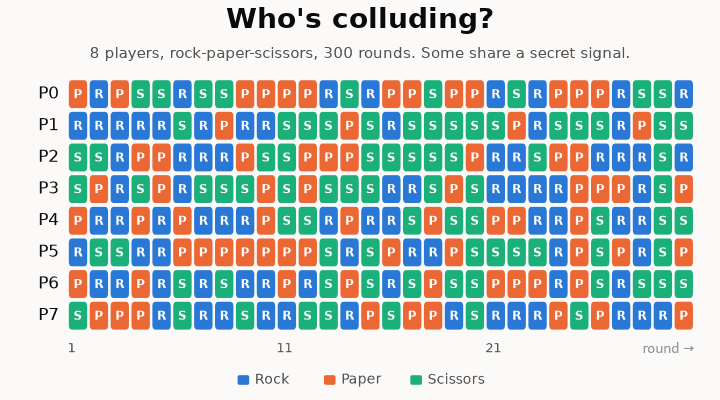

# Finding colluding groups from players' moves

<p align="center"></p>

<details>
<summary><b>Who's colluding? Click to reveal.</b> (Or play it yourself in the <a href="https://taruntrivedi3.github.io/collusion-detection/viewer/#rps/triangle">live viewer</a>.)</summary>
<p align="center"></p>
</details>

Apart Research AI Collusion Research Sprint (2026-10-23 to 2026-10-25), research question 1.4:
*can information-theoretic methods detect collusion in multi-agent games?*

**Claim.** The existing information-theoretic detector (pairwise net influence, Bonjour et al. 2022)
cannot see colluding groups of three or more. A shuffle-calibrated scan over groups finds them,
provided the test accounts for what honest agents react to. We show this requirement also holds for
LLM agents: in a market where the recorded state is everything the agents see, the test catches
colluding LLM sellers and stays quiet on the controls.

| | Finding | Evidence |
|---|---|---|
| 1 | **The pairwise method fails on groups.** Inside a group its score cancels out: 0% of triangles, cliques and hubs found. Its fixed cutoff is also uncalibrated: with no collusion it flags 8–23% of short (100-round) games and never fires in longer ones. | [Fig. A](results/figures/figA_cancellation.png), [Fig. D](results/figures/figD_null_false_alarms.png) |
| 2 | **GroupScan finds weak, broad groups.** 5 colluders among 20 players, 100 rounds, coordinating 20% of the time: 48% exact recovery vs 5% for the best pairwise baseline. It loses where the colluders aren't all linked: on hubs (one leader, two helpers) the pair test does better (58% vs 34%). Collusion with no pairwise trace (xor) is invisible to every method here. | [Fig. C](results/figures/figC_weak_cliques.png), [Table 2](results/SUMMARY.md#table-2--where-groupscan-wins-and-loses) |
| 3 | **The test must condition on what honest players react to.** Ignore it and honest players are flagged in up to 100% of games; condition on it and false alarms return to about 5%. This holds for collusion that pays: a 4-player group that steers reacting players earns 2.6× what 4 honest exploiters earn, and, colluding 20–30% of the time, is found in 94–98% of 1000+-round games while the exploiters are flagged in 4–7%. | [Fig. E](results/figures/figE_state_false_alarms.png), [Table 7](results/SUMMARY.md#table-7--profitable-collusion-steer-group-vs-honest-exploiters) |
| 4 | **The requirement carries over to LLM agents.** In double auctions where every prompt is built only from a recorded coarse state, gpt-4.1-mini sellers with a message channel and profit pressure earn 49–65% more than the controls: 7.07 [6.76, 7.38] per hour, all sellers combined, vs 4.29–4.76 with 2 sellers, 8.20 [7.83, 8.59] vs 5.12–5.24 with 5 sellers. A history-conditioned shuffle test on how often sellers make the same move flags them in 8 of 10 20-game batches (2 sellers) and 19 of 20 5-game batches (5 sellers), and flags the controls in at most 2 of 10 and 0 of 20. The general CMI test has little power per batch (10% with 2 sellers), and coordination keyed to public moves, as in an explicit-cartel prompt, is invisible by construction. | [2 sellers](studies/llm_auction_2seller/README.md), [5 sellers](studies/llm_auction_5seller/README.md) |

Report: [report/report.md](report/report.md). Full write-up of the simulation results:
[results/SUMMARY.md](results/SUMMARY.md). Interactive
viewer: <https://taruntrivedi3.github.io/collusion-detection/viewer/>.

## See it

```bash
python viewer/export.py        # optional: regenerates viewer/data.js (a few minutes)
open viewer/index.html         # or any browser; no server needed (also live at the link above)
```

The viewer replays example games. You see the moves, the links between players, which group was
planted, and what each detector reported. It also shows 2- and 5-seller LLM auction games with the sellers' messages.
Deep links: `index.html#rps/steer`, `index.html#auction/comms_pressure`, `index.html#auction/5/comms_pressure`. LLM condition names:
`comms_off` (no messages, no pressure), `pressure_off` (CEO pressure, no messages) and `comms_pressure`
(both).

## Repository

```
collusion/      detector library: information estimates, shuffle tests, all detectors
experiments/    RPS experiments, one script per step (step1 … step5) + make_figures.py
results/        RPS outputs: figures/, per-step CSVs, SUMMARY.md, WRITEUP_NOTES.md (methods)
studies/
  llm_auction_5seller/       finding 4: LLM double auction, 5 sellers, 100 games/condition
  llm_auction_2seller/       finding 4: earlier 2-seller version and pilots, 200 games/condition
  auction_null_calibration/  appendix: recorded LLM markets from andyjliu/llm-agent-collusion
viewer/         interactive game viewer (static HTML)
tests/          unit tests for collusion/
scripts/        reproduce.py for the recorded-market study
```

**Appendix study, and why it isn't a main finding.** We ran GroupScan and
shuffle test on 75 recorded 5-seller markets from
[andyjliu/llm-agent-collusion](https://github.com/andyjliu/llm-agent-collusion/tree/2bb2a7e22860160d1fddb5d2e5cb460cc6ec6aff).
Their recorded paths share strong time trends that no available state captures without leaving nothing to
shuffle. The test was badly miscalibrated: 88.5% flags on independently resampled seller paths. A
same-pool fix did not carry over to held-out markets. This illustrates finding 3: without a state that
explains the honest behaviour, the test is not usable. See its
[interpretation](studies/auction_null_calibration/results/INTERPRETATION.md).

## Before the sprint

Before the sprint began, we read the papers, came up with a game plan, played around with a few toy
examples, and implemented the starting code. We also ran the recorded-market study in
`studies/auction_null_calibration/` (see the appendix note above), including its log parser in
`source_snapshot/`.

## Reproduce

Python 3.11+ on Linux. The recorded-market study also needs `g++` with C++17.

```bash
python -m venv .venv && source .venv/bin/activate
pip install -r requirements.txt
pytest -q tests

cd experiments && python make_figures.py A B C D E T     # figures from saved results
python step4_final.py ...                                 # see results/RESULTS_INDEX.md for every command and seed

python scripts/reproduce.py --output /tmp/auction-check   # recorded-market study checks (add --mode full for the full run)

cd studies/llm_auction_2seller && python rates.py runs/rates_v1 same_moves && python build_report.py
cd ../llm_auction_5seller && python analyze_n.py runs/n5_rates_v1 5,10,20 && python dry_run_n.py 300
```

No command above calls an LLM. `studies/llm_auction_2seller/llm_pilot.py` and
`studies/llm_auction_5seller/llm_pilot_n.py` rerun the auction games with new OpenAI API calls (about $6
and $14).
