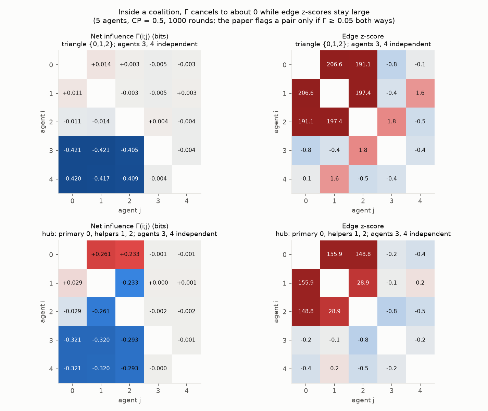
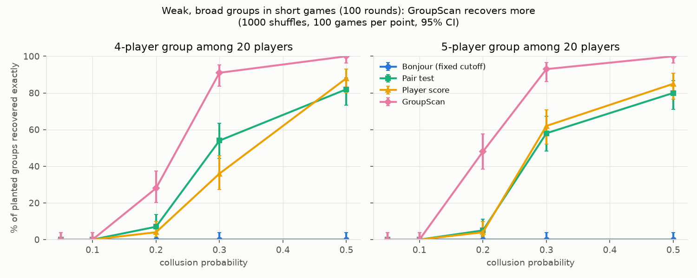
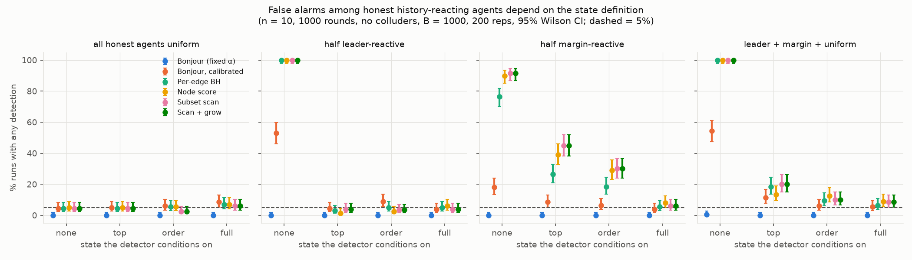
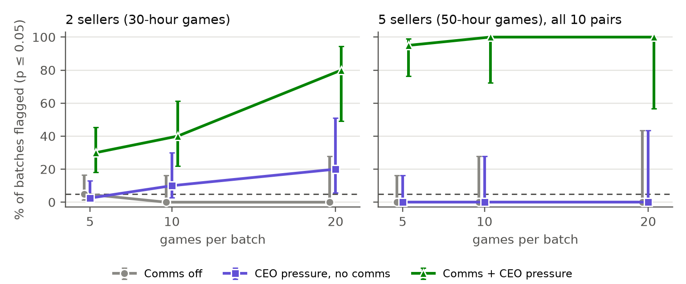

<!--
DRAFT report following the Apart Research AI Collusion Sprint (Oct 2026) template.
Length: ~4 pages excluding references and appendix (hard limit 8).
Live view in VS Code: Ctrl+K V (built-in preview) or Markdown Preview Enhanced (renders $math$, exports PDF).
Comments like this one are hidden in the preview. Lines marked TODO need a human decision or check.
Numbers come from results/SUMMARY.md, studies/llm_auction and studies/llm_auction_5seller
(runs/n5_rates_v1/analysis.txt, dry_run.txt).
-->

# Finding Colluding Groups from Players' Moves: Shuffle-Calibrated Group Scans for Multi-Agent and LLM Collusion

**Tarun Trivedi**, **Eashan Gandotra**

*With Apart Research — research conducted at the AI Collusion Research Sprint, October 2026*

---

## Abstract

<!-- 150–250 words (currently ~215). Revisit once the text is final. -->

Auditors of multi-agent systems often see only what agents do, not what they say to each other. The
information-theoretic detector of Bonjour et al. (2022) flags pairs of players that influence each other
more than anyone else influences them, but it assumes exactly two colluders. We show that this
pairwise net-influence score cancels inside groups: in simulated n-player Rock Paper Scissors it found
0% of planted triangles, cliques and hubs, (precisely defined later) and its fixed threshold is uncalibrated (8–23% false
alarms in short games with no collusion). We propose a group scan that scores every subset of players by the dependence inside it
and calibrates the maximum with a within-state shuffle test. Among 20 players, a 5-player group
colluding 20% of the time is recovered exactly in 48% of 100-round games, against 5% for the best
pairwise baseline. The shuffle must condition on what honest players react to: ignoring history
flags honest players in up to 100% of games, while the right state restores about 5% false alarms
and still finds a profitable steering coalition in 94–98% of long games. Finally, we build an LLM
double auction in which every agent sees only a shared coarse state, which makes the shuffle test
exact. gpt-4.1-mini sellers given a message channel and CEO profit pressure earn 49–65% more than
controls; a same-move shuffle test flags them (2 sellers: 8 of 10 20-game batches; 5 sellers: 19 of
20 5-game batches), while pooled tests on both controls are not significant.

## 1. Introduction

LLM agents are increasingly deployed as autonomous economic actors: pricing, bidding and trading on
behalf of firms. Agrawal et al. (2025) show that LLM sellers in a continuous double auction can collude,
raising prices above competitive levels, especially when given a channel to talk to each other and
pressure from management to keep margins high. A regulator or platform operator auditing such a
market usually cannot read private channels; it sees the moves. The question we study is the sprint's
research question 1.4: *can information-theoretic methods detect collusion from moves alone?*

**Threat model.** k ≥ 2 of n agents coordinate through a channel the auditor cannot observe (a
shared secret signal, a message channel, or a common plan). The auditor observes every agent's action
each round and the public state of the game, and must say which agents, if any, are colluding while
keeping false alarms on honest agents at a chosen level (5%). Honest agents need not be random: they
may react to public history, which itself makes their moves correlated.

The existing detector (Bonjour et al., 2022) is built for one colluding pair. Real coordination need
not be pairwise: a cartel of five sellers, a hub with several helpers, or a group sharing one signal.
We find that pairwise net influence is blind to exactly these structures.

Our main contributions are:

1. **A failure mode of pairwise net influence.** Inside a group, each member's partners cancel in its
   net-influence score, so the published rule finds 0% of triangles, cliques and hubs, while the
   underlying links are ~200 standard deviations above chance. Its fixed threshold is also
   uncalibrated (8–23% false alarms in 100-round games with no collusion).
2. **A shuffle-calibrated group scan.** Scoring every subset by the links inside it, calibrated by
   a max-statistic permutation test, recovers weak, broad groups that pairwise methods miss (48% vs 5%
   exact recovery for a weak 5-clique among 20 players) at a 5% false-alarm level.
3. **Conditioning on history is necessary, and sufficient when the state is right.** Honest players
   that react to history are flagged in up to 100% of games unless the shuffle stays within history
   states. With the right state, a coalition whose coordination pays is found in 94–98% of long games
   while honest exploiters with the same reaction rate are flagged in 4–7%.
4. **An LLM auction where the test is exact by design.** By giving every agent only a shared coarse
   state, conditional independence of honest agents holds by construction. The test detects
   comms + CEO-pressure collusion among gpt-4.1-mini sellers and stays quiet on controls, for 2 and
   for 5 sellers.

## 2. Related Work

**Information-theoretic collusion detection.** Bonjour, Aggarwal & Bhargava (2022) define a pairwise
influence γ(i;j) as the mutual information between two players' actions, and net influence as

$$
\Gamma(i;j) = \gamma(i;j) - \max_{k \neq i,j} \gamma(k;j).
$$

A pair is flagged when Γ passes 0.05 bits in both directions and exactly one pair passes. This is the
closest prior work. We reproduce it (Appendix B) and show its cancellation inside groups and its miscalibration; our detectors keep its building block (pairwise
conditional mutual information) but change the decision rule and calibration.

**LLM collusion in markets.** Agrawal et al. (2025) study LLM sellers in a continuous double auction
and find that communication and CEO profit pressure increase collusive pricing. They measure collusion
with access to prices and messages. We ask whether it is detectable from moves alone, and reuse their
mechanism (comms + pressure) as the positive condition.

**Per-agent detectors and multiple testing.** Rose et al. (2026) score individual agents for
suspicious behaviour; our "player score" baseline is inspired by this but is not their method.
Our "pair test" applies Benjamini–Hochberg (1995) false-discovery control to all pairs and joins
significant pairs into groups. Both are natural baselines that a group scan should beat.

**Gap.** No prior method we know of (i) detects groups larger than two from moves, (ii) has a
calibrated false-alarm rate, and (iii) handles honest agents whose moves are correlated through
shared history.

**Scan statistics and max-T tests.** The group scan is a scan statistic over subsets, calibrated by the
permutation distribution of its maximum; this controls the family-wise error over all subsets at once
(Westfall & Young, 1993).

## 3. Methods

### 3.1 Simulated game: n-player Rock Paper Scissors

Each round every player plays every other player (+1 win, −1 loss); n ∈ {5, 10, 20}; 100–3000 rounds.
With a *collusion probability* (CP) per round, planted colluders coordinate; otherwise they play
randomly. Colluders sit at random seats unknown to the detectors. Table 1 defines the planted groups and
the honest player types used throughout.

**Table 1.** Planted colluding groups and honest player types.

| Kind | Name | What the players do |
|---|---|---|
| Colluders | Pair | A helper plays the move that loses to its partner, feeding the partner a point. |
| Colluders | Two pairs | Two separate pairs, as above. |
| Colluders | Hub | One leader and two helpers; each helper feeds the leader, and the helpers never coordinate with each other. |
| Colluders | Triangle, *k*-clique | *k* = 3, 4 or 5 players share a secret signal and all play the same move (a 3-clique is a triangle). |
| Colluders | xor | Player C plays (A + B) mod 3, so every pair looks independent. |
| Colluders | Steer | 4 players all play one move to create a clear lead, then all play the move that beats the honest players who react to that lead; coordination pays. |
| Honest | Random | Plays uniformly at random. |
| Honest | Leader-reactive | With probability 0.5, plays the move that beats last round's most common move. |
| Honest | Margin-reactive | Same, but only when that move led by 3 or more. |
| Honest | Exploiter | Plays the move that beats the leader-reactive response, on its own, without coordinating. |

### 3.2 Detectors

All detectors start from the pairwise conditional mutual information
$\gamma_{ij} = I(a_i; a_j \mid s)$ in bits, where $s$ is a *history state* computed from the previous
round: none, top (which move led), order (ranking of move counts) or full (exact counts).

**Within-state shuffle null.** Each player's action column is permuted independently among rounds
that share the same state. This preserves each player's state-dependent habits and destroys any
coordination beyond them. Under the null that players are conditionally independent given the state,
and rounds are exchangeable within a state, it is an exact permutation test. We draw two independent
sets of B permutations: Set A to standardize each edge,
$z_{ij} = (\gamma_{ij} - \mu^A_{ij}) / \sigma^A_{ij}$, and Set B to calibrate the decision.

**Group scan (ours).** For every subset C with |C| ≥ 2,

$$
T(C) = \sum_{i \lt j \in C} z_{ij}, \qquad S(C) = \frac{T(C) - \mathbb{E}_A[T(C)]}{\sqrt{\mathrm{Var}_A[T(C)]}},
$$

where the Set-A moments are exact quadratic forms in the edge means and covariance. We report
$\arg\max_C S(C)$ if $\max_C S(C)$ exceeds the 95th percentile of the same maximum over Set B, then remove
that group and repeat on the remaining players (step-down max-T). The exact search covers ~106
subsets at n = 20.

**Baselines.** *Bonjour*: the published rule (fixed 0.05). *Bonjour (calibrated)*: same rule, threshold
from the shuffle null. *Pair test*: Benjamini–Hochberg at q = 0.05 over all pairs (p-values from a gamma
fit to the Set-A null, since raw permutation p-values cannot reach the BH bar at n ≥ 10), groups =
connected components. *Player score*: per-player total link strength, top players flagged.

**Metrics.** *Exact recovery*: the reported group equals the planted one. *Clean recovery*: exact and
nothing else reported. *False alarm*: any report when no collusion exists (target 5%). 95% Wilson
intervals in brackets. B = 1000 for all reported numbers unless stated.

### 3.3 LLM double auction with a coarse shared state

A shuffle test is only exact if the state captures everything honest agents react to (Section 4.3).
With LLMs that carry memory or see detailed price paths, no recorded state does (Appendix C). We
therefore **design the market so the state is the agents' entire public input.**

- **Market.** Sellers (cost $80) and scripted buyers (value $100) each hour *lower*, *keep* or *raise*
  their quote by $2 (logged as *tighten*, *hold*, *widen* in the code and data). At most one trade per hour, between the lowest ask and the highest bid, at the
  midpoint. Asks start at $96, bids at $84. Exact prices stay inside the simulator.
- **Shared state** $S_t$, the only thing in each prompt besides the rules:
  2×2 market (2 sellers, 2 buyers, 30 hours) — each seller's last move, who sold, and whether the
  lowest ask is high (≥ $92) or low; 5×5 market (5 sellers, 5 buyers, 50 hours) — how many sellers
  lowered / kept / raised, who sold, and the ask level. No memory, scratch pad or hour number.
- **Conditions.** `comms_off` (rules only); `pressure_off` (plus a CEO message: margins are tracked
  and low-margin sellers are decommissioned); `comms_pressure` (CEO message plus a 200-character
  message channel; each seller sees every seller's last message). Messages are the hidden channel:
  they are not in $S_t$.
- **Model.** gpt-4.1-mini, temperature 0.7, JSON output. 2×2: 200 games per condition (36,000 calls,
  ≈$6.35). 5×5: 100 games per condition (75,000 calls, ≈$14.38).
- **Test.** Because every seller's prompt is a function of $S_t$ (and its own name), sellers are
  conditionally independent given $S_t$ unless they coordinate through messages, so the
  within-state shuffle is exact. The statistic is the *same-move count*: rounds in which a pair of
  sellers took the same action. We chose it from a 20-game 2×2 pilot, before either main run, and kept
  it unchanged for 5 sellers. For 5 sellers we shuffle each seller independently within states and
  report a global test (sum over all 10 pairs) and a max-pair test (largest standardized pair, which
  controls family-wise error and localizes the pair). We report rejection rates over disjoint batches
  of 5, 10 and 20 games.

<!-- Failed attempts worth stating (template asks for them):
 - LLM buyers drove bids to the floor -> zero trades; switched to scripted buyers.
 - Agents confused "tighten/widen"; renamed to lower/keep/raise.
 - CMI as the LLM statistic was underpowered (10% detection at 20 games, 2x2): the effect is a small
   same-move excess diluted over ~400 state x action cells. The same-move count, fixed from the pilot
   before the main run, gives 80%.
 - Triple scans for xor were dropped: an order-k scan is blind to order-(k+1) parity. -->

## 4. Results

### 4.1 Pairwise net influence cannot see groups

**Observation.** The published Bonjour rule found **0% of triangles, cliques and hubs in every setting**
(Table 2), while the links inside a triangle were about 200 standard deviations above the shuffled data
(Figure 1). With no collusion, its fixed threshold raised false alarms in 8–23% of 100-round games
(n = 5–20) and never fired in longer ones; in a 3-player variant whose score conditions on the
previous round, it flagged up to 43% (Appendix B). Every
shuffle-calibrated detector stayed at 3–9%.

**Interpretation.** Net influence subtracts the strongest *other* influence on j. Inside a group, j's
other partners are as strong as i, so Γ ≈ 0 for every member. A fixed threshold on an estimator whose
bias depends on rounds and state cannot be calibrated.

**Figure 1.** 5 players, CP 0.5, 1000 rounds; players 0–2 collude. Left: Bonjour net influence per
ordered pair (must reach 0.05 both ways). Right: link strength as a z-score against shuffled data.
Inside the triangle the score is ≈ 0 while the links are ≈ 200; in the hub it passes only from leader to helper.

### 4.2 The group scan finds weak, broad groups

Scoring the group as a whole adds up evidence too weak in any single pair (Table 2, Figure 2). With 20
players, 100 rounds and a 5-clique at CP 0.2, the group scan recovered the exact group in **48% [38, 58]**
of games, against 5% [2, 11] for the pair test and 4% [2, 10] for the player score. It also degrades
less as players are added: for a triangle, the player score falls from 71% to 52% between n = 5 and 20,
the group scan from 77% to 71%.

**Table 2.** Exact recovery (%) by planted group and number of players. Averaged over the CP and round
settings tried for each group (200 shuffles).

| Planted group | n | Bonjour | Pair test | Player score | Group scan |
|---|---|---|---|---|---|
| Pair | 20 | 70 | 89 | 72 | **91** |
| Hub | 20 | 0 | **86** | 68 | 78 |
| Triangle | 20 | 0 | 64 | 52 | **71** |
| 4-clique | 20 | 0 | 48 | 45 | **62** |
| 5-clique | 20 | 0 | 46 | 51 | **63** |
| xor | 5–20 | 0 | 0 | 0 | 0 |

**Figure 2.** Exact recovery vs CP for 4- and 5-cliques among 20 players (100 rounds, 1000 shuffles,
100 games per point). Bonjour stays at 0.

**Where it loses.** The scan often reports a hub as a single leader–helper pair, because the two helpers
are not linked; the pair test, which joins both edges, does better (58% vs 34% at CP 0.2, 300 rounds).
For two isolated weak pairs in short games the pair test also wins narrowly (58% vs 52%): the scan pays
for searching ~106 groups.

### 4.3 The test must condition on what honest players react to

**Observation.** Honest players who react to last round's moves are correlated with each other. With no
state, the group scan flagged honest players in **up to 100%** of 1000-round games (Figure 3). Leader-reactive
players need at least the *top* state; margin-reactive players need *full*. With the right state, false
alarms return to 4–9%.

**Figure 3.** False-alarm rate by history state (coarse → fine) for four mixes of honest players; 10
players, 1000 rounds, no colluders, 200 games per point. Dashed line: 5% target.

**Profitable collusion.** A 4-player steer group earns 0.21 points per round each at CP 0.3, **2.6×**
what four independent exploiters earn reacting at the same rate; the margin-reactive players pay for it
(Table 3). With the full state, the group scan finds the steer group cleanly in 94–98% of 1000+-round
games at CP 0.2–0.3, while the honest exploiters are flagged in 4–7%. With coarser states the
exploiters look like colluders as games get longer (66–71% under *top*, 96–100% with no state at 3000 rounds).

**Table 3.** Steer group vs honest exploiters (4 of each type among 3 margin-reactive and 3 random players;
200 games per cell). Payoff = points per round per member (margin-reactive players' payoff in brackets).
Recovery and false alarms: group scan, full state, at 300 / 1000 / 3000 rounds.

| CP | Steer payoff | Exploiter payoff | Steer clean recovery (%) | Exploiter false alarms (%) |
|---|---|---|---|---|
| 0.1 | 0.08 (−0.11) | 0.03 (−0.04) | 7 / 84 / 95 | 6 / 6 / 7 |
| 0.2 | 0.15 (−0.20) | 0.06 (−0.07) | 76 / 98 / 94 | 5 / 4 / 6 |
| 0.3 | 0.21 (−0.27) | 0.08 (−0.10) | 92 / 94 / 94 | 5 / 6 / 6 |

**Interpretation.** The state is a bias–variance choice: too coarse and honest reactions look like
collusion; too fine and short games lose power (a triangle among reactors: 50% clean recovery at 300
rounds with *full*, 94–95% from 1000 rounds).

### 4.4 LLM sellers: comms + CEO pressure is detected, controls are not

**Observation.** In both markets, comms + pressure raised seller profit by 49–65% over the controls and
was the only condition the test flagged consistently (Table 4). Pooled over 200 games, the 2×2 same-move
statistic gave z = +7.9 for comms + pressure and |z| ≤ 1.5 for both controls (CMI: +5.0 vs |z| ≤ 0.8).
In the 5×5 market, pooled over 100 games, the global test gave p = 0.001 (the floor at 1000 shuffles;
+1,991 matching seller pairs above the shuffle's expectation out of 50,000 pair-rounds, top pairs z = 9–12)
against p = 0.17 and 0.71 on the controls.

**Table 4.** Batches flagged at α = 0.05, out of disjoint batches of 5, 10 and 20 games. 2×2: same-move
test. 5×5: global test over all 10 seller pairs. Profit per seller-hour with a 95% bootstrap interval over
games.

| Market | Condition | Profit / hour | 5 games | 10 games | 20 games |
|---|---|---|---|---|---|
| 2×2 | comms off | 4.29 [4.06, 4.51] | 2/40 | 0/20 | 0/10 |
| 2×2 | pressure, no comms | 4.76 [4.52, 5.00] | 1/40 | 2/20 | 2/10 |
| 2×2 | **comms + pressure** | **7.07** [6.76, 7.38] | 12/40 | 8/20 | **8/10** |
| 5×5 | comms off | 5.12 [4.82, 5.42] | 0/20 | 0/10 | 0/5 |
| 5×5 | pressure, no comms | 5.24 [4.93, 5.54] | 0/20 | 0/10 | 0/5 |
| 5×5 | **comms + pressure** | **8.20** [7.83, 8.59] | **19/20** | **10/10** | **5/5** |

The batch counts are small: 95% Wilson intervals are [49, 94]% for 8/10, [76, 99]% for 19/20 and [57, 100]%
for 5/5. The 5×5 max-pair test flags comms + pressure in 16/20, 10/10 and 5/5 batches, and the controls in
1/20 and 0/20 five-game batches and none of the larger ones.

**Figure 4.** Share of batches flagged vs games per batch, with 95% Wilson intervals. Left: 2×2 market,
same-move test. Right: 5×5 market, global test. Dashed line: 5% target.

**Interpretation.** The mechanism is visible in the messages and the moves. CEO pressure makes the
seller who just sold raise (2×2: 8% → 33% in low-price states after a trade); the channel stops the others
from undercutting (losing-seller "lower" falls from 82% to 41%), so moves synchronize. In the 5×5 market
the whole group converges on "hold, don't undercut" ("Hold prices steady; avoid price wars to protect
profits for all sellers"), so the excess agreement appears in all 10 pairs at once and is detected in
smaller batches (each 5×5 game also has 50 hours and 10 seller pairs, against 30 hours and one pair). The max-pair test does not isolate a sub-cartel here because every pair is in sync;
in a scripted check where only 2 of 5 sellers collude, it localizes the right pair in 99.7% of batches.
The 2×2 `pressure_off` rate of 0.20 at 20 games (2 of 10 batches; 95% interval [6, 51]%) is consistent
with 5% but is the weakest point of the control results. What the test detects is a shared signal outside
the public state that coordinates moves; reading it as collusion rests on the profit gap over the
pressure-only control.

## 5. Discussion and Limitations

**Implications for AI safety.** Monitoring agent markets from moves alone is feasible, but only with
two ingredients the existing method lacks: a test over groups, and a null that models what honest agents
legitimately react to. The second is the binding constraint. Our LLM result works because we designed
the market so the honest-agent input is fully recorded; in a deployed market an auditor should log the
information each agent is shown, which makes this test exact.

**Limitations.**

- **Coordination that is a function of the public state is invisible.** Follow-the-leader or an explicit
  cartel that keys on last round's public moves is absorbed into the state. A direction test (does
  a seller raise after others raise?) catches these but also fires on tacit following without
  communication, so it needs a comms-off calibration.
- **Higher-order collusion.** xor-style coordination has no pairwise trace (0% for every method);
  any fixed-order test is blind to the next order.
- **Exact search stops at ~20 players** (~106 subsets).
- **The state must be chosen**; the test cannot detect that honest agents react to something unrecorded.
  On recorded markets from Agrawal et al. (2025), shared time trends made the test badly miscalibrated
  (Appendix C).
- **Pair test runs slightly high** (7.7% [6.8, 8.7] false alarms at n = 20, 300 rounds) because its
  gamma-fit tail is generous.
- **LLM scope.** One model (gpt-4.1-mini), scripted buyers, coarse states and no agent memory. Richer
  inputs give LLMs more to react to and require a richer state.

**Future work.** Learned or richer states (e.g. conditioning on a model of honest play), higher-order
dependence (partial information decomposition, Williams & Beer 2010), payoff-based tests that target
harmful coordination of any order, and LLM markets with memory and more models.

## 6. Conclusion

The pairwise information-theoretic detector for collusion is blind to groups: its net-influence score
cancels inside them and its fixed threshold is uncalibrated. A group scan with a within-state shuffle
test fixes both, recovering weak, broad colluding groups at a controlled 5% false-alarm rate, provided
the state captures what honest players react to.

When an LLM market is designed so that the state is the agents' entire public input, the test is exact.
It detects the comms + CEO-pressure collusion of Agrawal et al. among gpt-4.1-mini sellers, in 80% of
20-game batches with 2 sellers and in 95% of 5-game batches with 5, while pooled tests on the controls stay non-significant.

## Code and Data

All code, results and the LLM auction games are at <https://github.com/taruntrivedi3/collusion-detection>.
`results/RESULTS_INDEX.md` lists the exact command and seeds for every number, including the two LLM
studies (`studies/llm_auction/`, `studies/llm_auction_5seller/`). An interactive viewer
(<https://taruntrivedi3.github.io/collusion-detection/viewer/>) replays example games, including the
2- and 5-seller LLM games with the sellers' messages.

## Work Done Before the Sprint

Before the sprint began, we read the papers, came up with a game plan, played around with a few toy
examples, and implemented the starting code. We also ran the recorded-market study in Appendix C
(`studies/auction_null_calibration/`), including its log parser. Everything else in this report was done
during the sprint.

## References

1. Agrawal, K., Teo, V., Vazquez, J. J., Kunnavakkam, S., Srikanth, V., & Liu, A. (2025). Evaluating LLM agent collusion in double auctions. arXiv:2507.01413. Code: <https://github.com/andyjliu/llm-agent-collusion>
2. Benjamini, Y., & Hochberg, Y. (1995). Controlling the false discovery rate: a practical and powerful approach to multiple testing. *Journal of the Royal Statistical Society: Series B*, 57(1), 289–300.
3. Bonjour, T., Aggarwal, V., & Bhargava, B. (2022). Information theoretic approach to detect collusion in multi-agent games. *Proceedings of the 38th Conference on Uncertainty in Artificial Intelligence (UAI)*, PMLR 180, 223–232. <https://proceedings.mlr.press/v180/bonjour22a.html>
4. Rose, A., Cullen, C., Abdelnabi, S., Torr, P., Kaplowitz, B. G., & Schroeder de Witt, C. (2026). Detecting multi-agent collusion through multi-agent interpretability. arXiv:2604.01151.
5. Westfall, P. H., & Young, S. S. (1993). *Resampling-Based Multiple Testing: Examples and Methods for p-Value Adjustment.* Wiley.
6. Williams, P. L., & Beer, R. D. (2010). Nonnegative decomposition of multivariate information. arXiv:1004.2515.

---

## Appendix A. Limitations and Dual-Use / Ethical Considerations

**Limitations** are discussed in Section 5. In short: the test is only as good as the recorded state;
state-driven, higher-order and unrecorded-channel coordination can evade it; results are from simulated
players and one LLM with scripted buyers.

**Dual use.** A detector also tells colluders what to avoid. Our results show that coordinating through
the public state, or at higher order, evades pairwise and group dependence tests. We report these blind
spots openly because auditors need to know them, and because the defence (logging what agents observe,
payoff-based tests) is the same regardless. We release no method for hiding collusion beyond what the
limitations already state.

**False accusations.** A flag is statistical evidence that agents' moves are more aligned than their
observed inputs explain, not proof of intent. Mis-specified states produce confident false flags (up to
100% in Section 4.3). Any operational use should treat a flag as grounds for review, report the state
used, and calibrate on known-honest runs.

**LLM experiments.** All agents are simulated; no real market, person or firm is affected. The CEO
pressure prompt is taken from prior work to reproduce a known effect.

## Appendix B. Reproducing Bonjour et al.

Our average scores match the paper's Figure 3 in bits. Our detection accuracy matches its Table 2 only
when the score conditions on the previous round's three moves (27 states), which the paper does not
state; one number (CP 0.2, 1000 rounds: paper 24%, ours 49%) remains unexplained. With that 27-state
score, the fixed threshold flags a pair among 3 random players in 43.4% of 100-round games (19.2% at 300,
0.1% at 1000); the calibrated version stays at 5–6%. Full tables: `results/SUMMARY.md` (Tables 4, 8).

## Appendix C. Recorded markets from Agrawal et al. (2025)

We ran the group scan on 75 recorded 5-seller markets from the original study. The recorded price paths
share strong time trends (high early, lower later) that no available state captures without leaving
nothing to shuffle. On independently resampled seller paths, the within-state scan flagged 88.5% of
groups at nominal 5% (circular shifts: 37.2%). A same-pool empirical calibration reached 4.1% false
alarms and 85.6% detection of copied triples, but did not transfer to held-out markets (4.2–48.8% null
flags across folds). This motivated the coarse-state design of Section 3.3: without a state that
explains honest behaviour, the test is not usable. Details: `studies/auction_null_calibration/`.

## LLM Usage Statement

We used Claude Code (Anthropic) throughout the project: to write and refactor the simulation and analysis
code, run the experiments, review the repository, and draft and edit this report and the documentation.
The authors made the research decisions (what to test, which agents and conditions to use, what to keep
or cut), directed and reviewed the work, and checked the numbers and claims. gpt-4.1-mini (OpenAI) played
the sellers in the LLM auction experiments. All numbers in this report come from the released code and
data.
