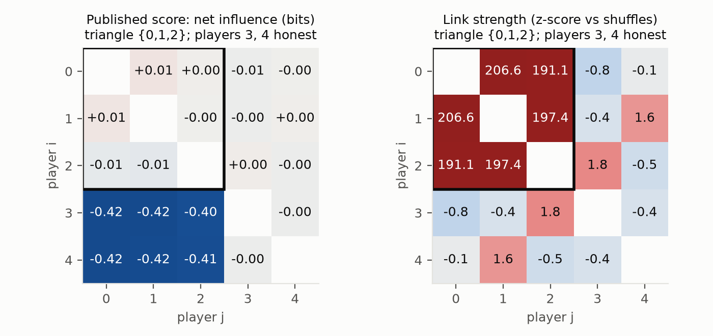
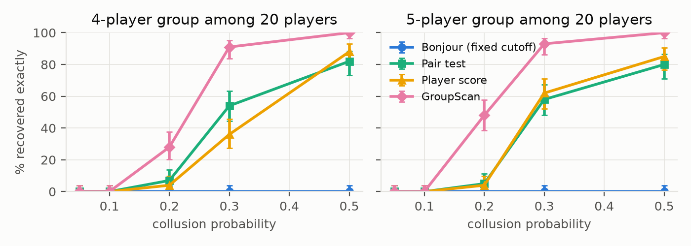
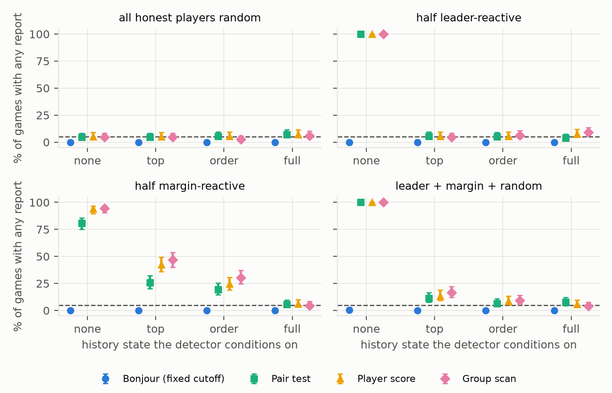

<!--
DRAFT report following the Apart Research AI Collusion Sprint (Oct 2026) template.
Length: main text (through Conclusion) must fit 8 pages; references and appendices follow.
Live view in VS Code: Ctrl+K V (built-in preview) or Markdown Preview Enhanced (renders $math$, exports PDF).
Comments like this one are hidden in the preview. Lines marked TODO need a human decision or check.
Numbers come from results/SUMMARY.md, studies/llm_auction and studies/llm_auction_5seller
(runs/n5_rates_v1/analysis.txt, dry_run.txt).
-->

# Beyond Pairs: Detecting Colluding Groups of Agents from Their Moves

**Tarun Trivedi** (Independent), **Eashan Gandotra** (Independent)

*With Apart Research — research conducted at the AI Collusion Research Sprint, October 2026*

---

## Abstract

<!-- 150–250 words (currently ~247). Plain terms only: hubs, cliques, history states etc. are defined in Section 3. -->

Auditors of multi-agent systems often see what agents do, not what they say to each other. The
information-theoretic detector of Bonjour et al. (2022) looks for one pair of players whose moves depend
on each other, so it cannot report a colluding group: in simulated many-player Rock Paper Scissors it found
none of the planted groups of three to five colluders, and its fixed threshold raised 8–23% false alarms
in short games without collusion. We propose a group scan that scores every subset of players by how much
their moves depend on each other and judges the best score against shuffled copies of the game. Among 20
players, a 5-player group colluding in 20% of rounds is found exactly in 48% of 100-round games, against
5% for the best pairwise method. The shuffle must respect what honest players react to: honest players who
respond to the previous round look like colluders in up to 100% of games unless rounds with the same
recent history are shuffled together, which keeps false alarms at 4–9% while still catching a group that
colludes for profit. In LLM double auctions where sellers see only a recorded summary of the last hour,
gpt-4.1-mini sellers given a message channel and profit pressure earn 56% more than with pressure
alone; the test flags them but not the controls, and it misses sellers who coordinate only by following
public moves. Moves-only auditing works if the auditor records what each agent sees and tests groups.

## 1. Introduction

LLM agents are increasingly deployed as autonomous economic actors: pricing, bidding and trading on
behalf of firms. Agrawal et al. (2025) show that LLM sellers in a double auction can collude, raising
prices, especially with a channel to talk to each other and pressure from management to keep margins
high. An auditor of such a market usually cannot read private channels; it sees the moves. We study the
sprint's research question 1.4: *can information-theoretic methods detect collusion from moves alone?*

**Threat model.** k ≥ 2 of n agents coordinate through a channel the auditor cannot observe (a shared
signal, a message channel, a common plan). The auditor sees every action and the public state, and must
say which agents, if any, collude, at a chosen false-alarm rate (5%). Honest agents need not be random:
they may react to public history, which itself correlates their moves. The existing detector (Bonjour
et al., 2022) is built for one colluding pair; real coordination may involve a group.

Our contributions:

1. **A failure mode of pairwise net influence.** Inside a group each member's partners cancel in its
   score, so the published rule rarely flags even one in-group pair (8–15% of games), although the links
   are ~200 standard deviations above chance; its fixed threshold is also uncalibrated.
2. **A shuffle-calibrated group scan** that recovers weak, broad groups pairwise methods miss (48% vs 5%
   for a weak 5-player group among 20) at near-nominal false-alarm rates; a per-pair test does better
   on hubs and isolated pairs.
3. **History conditioning is necessary.** Honest players who react to history are flagged in up to 100%
   of games unless the shuffle stays within history states; with the right state, a coalition whose
   coordination pays is found while honest exploiters are not.
4. **An LLM market where the null holds by design.** Each seller's prompt is built only from a logged
   coarse state, and a within-state same-move test detects comms + CEO-pressure collusion among
   five gpt-4.1-mini sellers while staying quiet on the controls.

## 2. Related Work

**Information-theoretic collusion detection.** Bonjour, Aggarwal & Bhargava (2022) define a pairwise
influence γ(i;j) as the mutual information between two players' actions given the game state, and net
influence as

$$
\Gamma(i;j) = \gamma(i;j) - \max_{k \neq i,j} \gamma(k;j).
$$

A pair is flagged when Γ passes a threshold α (0.05 in the paper's experiments) in both directions and
exactly one pair passes. This is the closest prior work; we reproduce it (Appendix B) and keep its
building block, pairwise conditional mutual information, but change the decision rule and calibration.

**LLM collusion in markets.** Agrawal et al. (2025) study LLM sellers in a continuous double auction
and find that a communication channel increases collusive pricing and that CEO profit pressure also
shapes it, measuring collusion from prices and messages. We ask whether it is detectable from moves
alone, and reuse comms + pressure as our positive condition.

**Per-agent detectors and multiple testing.** Rose et al. (2026) score individual agents for
suspicious behaviour; our "player score" baseline is inspired by this but is not their method.
Our "pair test" applies Benjamini–Hochberg (1995) false-discovery control to all pairs and joins
significant pairs into groups.

**Scan statistics.** Searching subsets for the most anomalous one and calibrating its maximum by
permutation is standard in disease and event surveillance (Kulldorff, 1997; Neill, 2012) and controls the
family-wise error over all subsets (max-T; Westfall & Young, 1993). What is new here is the target:
subsets of agents scored by their pairwise dependence, a null that shuffles only within history states,
and the confound of honest agents who react to the same history.

**Gap.** We know of no collusion detector that (i) reports groups larger than two from moves, (ii) has a
calibrated false-alarm rate, and (iii) handles honest agents correlated through shared history.

## 3. Methods

### 3.1 Simulated game: n-player Rock Paper Scissors

Each round every player plays every other player (+1 win, −1 loss); n ∈ {5, 10, 20}; 100–3000 rounds.
With a *collusion probability* (CP) per round, planted colluders coordinate; otherwise they play
randomly. Colluders sit at random seats unknown to the detectors. Table 1 defines the planted groups and
the honest player types used throughout.

**Table 1.** Planted colluding groups and honest player types.

| Kind | Name | What the players do |
|---|---|---|
| Colluders | Pair; two pairs | A helper plays the move that loses to its partner, feeding it a point. |
| Colluders | Hub | One leader, two helpers who each feed it and never coordinate with each other. |
| Colluders | Triangle, *k*-clique | *k* = 3–5 players share a secret signal and play the same move. |
| Colluders | xor | C plays (A + B) mod 3, so every pair looks independent. |
| Colluders | Steer | 4 players create a clear lead, then all beat the honest players who react to it. |
| Honest | Random | Plays uniformly at random. |
| Honest | Leader- / margin-reactive | W.p. 0.5 beats last round's most common move (margin: only if it led by ≥ 3). |
| Honest | Exploiter | On its own, w.p. CP / (1 + CP), beats the leader-reactive response. |

### 3.2 Detectors

All detectors start from the pairwise conditional mutual information (CMI)
$\gamma_{ij} = I(a_i; a_j \mid s)$ in bits, where $s$ is a *history state* computed from the previous
round: none, top (which move led), order (ranking of move counts) or full (exact counts).

**Within-state shuffle null.** Each player's action column is permuted independently among rounds
that share the same state. This preserves each player's state-dependent habits and destroys any
coordination beyond them. Under the null that players are conditionally independent given the state,
and rounds are exchangeable within a state, it is an exact permutation test.

**Group scan (ours).** Given every player's action in every round and the history state of each round:

1. **Edge statistics.** Compute $\gamma_{ij}$ for every pair of players on the observed data.
2. **Shuffle.** Draw two independent sets of B within-state shuffles, Set A and Set B, and compute every
   $\gamma_{ij}$ on each shuffled dataset.
3. **Standardize edges with Set A.** $z_{ij} = (\gamma_{ij} - \mu^A_{ij}) / \sigma^A_{ij}$, where
   $\mu^A_{ij}$ and $\sigma^A_{ij}$ are the mean and standard deviation of $\gamma_{ij}$ over Set A. The
   Set-B datasets are standardized with the same Set-A moments.
4. **Score every group.** For every subset C with |C| ≥ 2 (~106 subsets at n = 20), compute
   T(C) and S(C) below, where the Set-A moments are exact quadratic forms in the edge means and covariance.

$$
T(C) = \sum_{i \lt j \in C} z_{ij}, \qquad S(C) = \frac{T(C) - \mathbb{E}_A[T(C)]}{\sqrt{\mathrm{Var}_A[T(C)]}}.
$$

5. **Calibrate with Set B.** Compute $\max_C S(C)$ on each Set-B dataset; the threshold is the 95th
   percentile of these B maxima.
6. **Decide.** If the observed $\max_C S(C)$ exceeds the threshold, report $\arg\max_C S(C)$ as a
   colluding group; otherwise stop.
7. **Remove and repeat.** Drop the reported group's players and return to step 4 on the remaining
   players, with the threshold recomputed among them (a sequential extension of the single max-T test).
   Stop when no group passes or fewer than two players remain.

**Baselines.** *Bonjour*: the published rule (fixed 0.05). *Bonjour (calibrated)*: same rule, threshold
from the shuffle null. *Pair test*: Benjamini–Hochberg at q = 0.05 over all pairs (p-values from a gamma
fit to the Set-A null, since with 200 shuffles raw permutation p-values cannot reach the BH bar at n ≥ 10), groups =
connected components. *Player score*: per-player total link strength, top players flagged.

**Metrics.** *Exact recovery*: the reported group equals the planted one. *Clean recovery*: exact and
nothing else reported. *False alarm*: any report when no collusion exists (target 5%). 95% Wilson
intervals in brackets. B = 1000 shuffles throughout unless stated.

### 3.3 LLM double auction with a coarse shared state

The LLM study asks whether the within-state shuffle null of §3.2 carries over to LLM agents. It is only
valid if the state captures everything honest agents react to (Section 4.3), and with LLMs that carry
memory or see detailed price paths no recorded state does (Appendix C). We therefore **design the market
so the state is the agents' entire public input.**

- **Market.** 5 LLM sellers (cost $80) and 5 scripted buyers (value $100), 50 hours per game. Each hour
  every agent lowers, keeps or raises its quote by $2; at most one trade per hour, between the lowest ask
  and the highest bid, at the midpoint. Exact prices stay inside the simulator.
- **Shared state** $S_t$, the only thing in each prompt besides the rules: how many sellers lowered /
  kept / raised last hour, who sold, and whether the lowest ask is high (≥ $92) or low. No memory,
  scratch pad or hour number.
- **Conditions** (100 games each): *comms off* (rules only); *pressure, no comms* (plus a CEO message:
  margins are tracked and low-margin sellers are decommissioned); *comms + pressure* (plus a 200-character
  message channel; each seller sees every seller's last message). Messages are not in $S_t$.
  gpt-4.1-mini, temperature 0.7; 75,000 calls (≈$14).
- **Test.** Sellers are conditionally independent given $S_t$ unless something outside it links them, so
  any message that changes moves breaks the null, collusive or not. Exchangeability within a state is
  approximate ($S_{t+1}$ depends on moves at $t$); in a scripted check (300 replications of 20 games) the
  tests gave 4.3% and 5.0% false alarms at a 5% target. The statistic is the *same-move count* of each
  seller pair, chosen in earlier 2-seller runs (Appendix D) where CMI was underpowered, and fixed
  before this run. The *global test* sums it over all 10 pairs; the *max-pair test* takes the largest
  standardized pair, which controls family-wise error and names the pair.

**What did not work.** LLM buyers drove bids to the floor, so we switched to scripted buyers; CMI was
underpowered as the LLM statistic (Appendix D); and triple scans for xor were dropped, since a test over
triples is blind to the same construction with four players.

## 4. Results

### 4.1 Pairwise net influence cannot see groups

**Observation.** The published rule reports exactly one pair, so it cannot recover a group of three or
more by construction (0% in Table 2). More telling, it rarely flags even one in-group pair: 15% of
triangle games, 12% of 4- and 5-clique games and 8% of hub games (5–20 players), close to its
false-alarm rate, while the links inside a triangle are about 200 standard deviations above the shuffled
data (Figure 1). With no collusion its fixed threshold raised false alarms in 8–23% of 100-round games
and never fired in longer ones (up to 43% in a 3-player variant that conditions on the previous round;
Appendix B). Every shuffle-calibrated detector stayed at 3–9%.

**Interpretation.** Net influence subtracts the strongest *other* influence on j. Inside a group, j's
other partners are as strong as i, so Γ ≈ 0 for every member. A fixed threshold on an estimator whose
bias depends on rounds and state cannot be calibrated.

**Figure 1.** 5 players, CP 0.5, 1000 rounds; players 0–2 form a triangle, 3–4 are honest. Each cell is
row player i → column player j. Left: Bonjour net influence (a pair is flagged only if it reaches 0.05 in
both directions). Right: link strength as a z-score against shuffled data. Inside the triangle the score
is ≈ 0 while the links are ≈ 200. The dark cells from honest to colluding players are negative because
each colluder's strongest influence comes from another colluder.

### 4.2 The group scan finds weak, broad groups

Scoring the group as a whole adds up evidence too weak in any single pair. With 20 players, 100 rounds
and a 5-clique at CP 0.2, the group scan recovered the exact group in **48% [38, 58]** of games, against
5% [2, 11] for the pair test and 4% [2, 10] for the player score (Figure 2). It also degrades less as
players are added: for a triangle at CP 0.2 and 300 rounds, the player score falls from 93% to 32% between
5 and 20 players, the group scan from 93% to 84% (Table 2). We plant groups of 3–5 because larger groups have more linked pairs and
are easier for every method; the scan searches all sizes, and recovers even an 18-of-20 cartel in 96–100%
of games from CP 0.3 (`results/SUMMARY.md`).

**Table 2.** Exact recovery (%) at one setting every group was run at: CP 0.2, 300 rounds, 200 shuffles,
20 players (triangle also at 5), 50 games per cell at 20 players and 100 at 5; 95% Wilson intervals for the
two strongest methods.

| Planted group | Bonjour | Pair test | Player score | Group scan |
|---|---|---|---|---|
| Pair | 34 | **70** [56, 81] | 8 | 64 [50, 76] |
| Two pairs | 23 | **69** [59, 77] | 6 | 60 [50, 69] |
| Hub | 0 | **66** [52, 78] | 2 | 44 [31, 58] |
| Triangle (5 players) | 0 | 83 [74, 89] | 93 | **93** [86, 97] |
| Triangle | 0 | 70 [56, 81] | 32 | **84** [71, 92] |
| 4-clique | 0 | 78 [65, 87] | 66 | **90** [79, 96] |
| 5-clique | 0 | 78 [65, 87] | 90 | **96** [87, 99] |
| xor | 0 | 0 | 0 | 0 |

**Figure 2.** Exact recovery vs CP for 4- and 5-cliques among 20 players (100 rounds, 1000 shuffles,
100 games per point, 95% Wilson intervals). Bonjour stays at 0.

**Where it loses.** On hubs the pair test does better (66% vs 44%, Table 2): the scan often reports one
leader–helper pair, because the two helpers are linked only indirectly (z ≈ 29, against ≈ 150 for
leader–helper links; 5 players, CP 0.5). On single and two separate weak pairs the pair test also edges
ahead (70 vs 64 and 69 vs 60; intervals overlap): for a lone link, the scan pays for searching ~106
groups, while a per-pair correction is cheaper.

### 4.3 The test must condition on what honest players react to

**Observation.** Honest players who react to last round's moves are correlated with each other. With no
state, the group scan flagged them in **up to 100%** of 1000-round games (Figure 3). Leader-reactive
players need at least the *top* state, margin-reactive players *full*; with the right state, false alarms
are 4–9%.

**Figure 3.** False-alarm rate by history state (coarse → fine) for four mixes of honest players; 10
players, 1000 rounds, no colluders, 200 games per point, 95% Wilson intervals. Dashed line: 5% target.
Bonjour's fixed rule (grey) sits at 0 because its cutoff never fires at 1000 rounds, not because it is
calibrated.

**Profitable collusion.** A 4-player steer group earns 0.21 points per round each at CP 0.3, **2.6×**
what four independent exploiters earn reacting at the same rate; the margin-reactive players pay for it
(Table 3). With the full state, the group scan finds the steer group cleanly in 94–98% of 1000+-round
games at CP 0.2–0.3, while the honest exploiters are flagged in 4–7%. With coarser states the
exploiters look like colluders as games get longer (66–71% under *top*, 96–100% with no state at 3000 rounds).

**Table 3.** Steer group vs honest exploiters. Each game has either 4 steer colluders or 4 exploiters, plus
3 margin-reactive and 3 random players; 200 games per cell. Payoff = points per round per member, averaged
over 300–3000 rounds (random play earns 0; margin-reactive players' payoff in brackets). Recovery and false
alarms: group scan, full state, at 300 / 1000 / 3000 rounds.

| CP | Steer payoff | Exploiter payoff | Steer clean recovery (%) | Exploiter false alarms (%) |
|---|---|---|---|---|
| 0.1 | 0.08 (−0.11) | 0.03 (−0.04) | 7 / 84 / 95 | 6 / 6 / 7 |
| 0.2 | 0.15 (−0.20) | 0.06 (−0.07) | 76 / 98 / 94 | 5 / 4 / 6 |
| 0.3 | 0.21 (−0.27) | 0.08 (−0.10) | 92 / 94 / 94 | 5 / 6 / 6 |

**Interpretation.** The state is a bias–variance choice: too coarse and honest reactions look like
collusion; too fine and short games lose power (a triangle among reactors: 50% clean recovery at 300
rounds with *full*, 94–95% from 1000 rounds).

### 4.4 LLM sellers: comms + CEO pressure is detected, controls are not

**Observation.** Comms + pressure raised sellers' combined profit by 56% over pressure alone and 60% over
neither (Table 4): the mean trade price rose from $85.5 to $89.1 while trades fell from 95% to 90% of
hours. Pooled over 100 games, the global test gave p = 0.001 (the floor at 1,000 shuffles; 1,991 more
matching seller pairs than the shuffle expects, out of 50,000 pair-hours; top pairs z = 9–12) against
p = 0.17 and 0.71 on the controls. Raw agreement alone would not show this: comms + pressure sellers made
the same move in 66.8% of pair-hours against 62.8% expected within states, while sellers with no channel
and no pressure agreed more often (68.6%) because they all lowered together.

**Table 4.** Batches flagged by the global test at α = 0.05, out of disjoint batches of 5, 10 and 20 games
(95% Wilson intervals: 19/20 → [76, 99]%, 5/5 → [57, 100]%). Profit: all sellers combined, $ per hour,
95% bootstrap interval over games.

| Condition | Sellers' profit / hour | 5 games | 10 games | 20 games |
|---|---|---|---|---|
| comms off | 5.12 [4.82, 5.42] | 0/20 | 0/10 | 0/5 |
| pressure, no comms | 5.24 [4.93, 5.54] | 0/20 | 0/10 | 0/5 |
| **comms + pressure** | **8.20** [7.83, 8.59] | **19/20** | **10/10** | **5/5** |

**Interpretation.** The sellers converge on "hold, don't undercut" (e.g. "Maintain stable asks; avoid price
wars to protect profits for all sellers.", seed 102, hour 25), so the excess agreement appears in all 10
pairs at once. For the same reason the max-pair test (16/20, 10/10, 5/5 batches) cannot isolate a sub-cartel (the controls are flagged in 1/20 and 0/20 five-game batches); in a scripted check where only two of five sellers coordinate in 10% of hours,
it names the right pair in 99.7% of batches. What the test detects is a shared signal outside the logged
state; reading it as collusion rests on the profit gap over the pressure-only control.

## 5. Discussion and Limitations

**Implications for AI safety.** Auditing agent markets from moves alone is feasible with two ingredients
the existing method lacks: a test over groups, and a null that models what honest agents legitimately
react to. The second is the binding constraint. In a deployed market the auditor should log what each
agent is shown; the test is then valid when decisions depend only on what is logged. It flags any shared
signal outside the log, collusive or not, so calling a flag collusion needs an outcome check such as the
profit gap.

**An auditor's recipe.** (1) Log what each agent observes each round. (2) Run the group scan with a shuffle
that stays within those logged states. (3) Before calling a flagged group collusion, compare its payoff
with a comparable honest baseline.

**Limitations** (details in Appendix A). Coordination that is a function of the public state is
invisible: in 2-seller pilots (Appendix D) the test missed sellers told to form an explicit cartel, who
earned 7.63 per hour against 4.72 with comms off, because they coordinated by following last hour's
public moves. So is coordination with no pairwise trace (xor). The exact search stops at about 20
players, the state must be chosen by the auditor, and the LLM results use one model, scripted buyers and
no memory.

**Future work.** Learned or richer states (e.g. conditioning on a model of honest play), higher-order
dependence (partial information decomposition, Williams & Beer 2010), payoff-based tests that target
harmful coordination of any order, and LLM markets with memory and more models.

## 6. Conclusion

The pairwise information-theoretic detector for collusion is blind to groups: its net-influence score
cancels inside them and its fixed threshold is uncalibrated. A group scan with a within-state shuffle
test recovers weak, broad colluding groups at near-nominal false-alarm rates (3–9% at a 5% target),
provided the state captures what honest players react to. In LLM markets where each seller's prompt is
built only from a logged state, the same-move version of the test detects comms + CEO-pressure collusion
among gpt-4.1-mini sellers (19 of 20 five-game batches) and
not the controls.

## Code and Data

All code, results and the LLM auction games are at <https://github.com/taruntrivedi3/collusion-detection>.
`results/RESULTS_INDEX.md` lists the exact command and seeds for every number, including the two LLM
studies (`studies/llm_auction/`, `studies/llm_auction_5seller/`). An interactive viewer
(<https://taruntrivedi3.github.io/collusion-detection/viewer/>) replays example games, including the
2- and 5-seller LLM games with the sellers' messages.

## Work Done Before the Sprint

Before the sprint began, we read the papers, came up with a game plan, played around with a few toy
examples, and implemented the starting code. We also ran the recorded-market study in Appendix C
(`studies/auction_null_calibration/`), including its log parser. Everything else in this report was done
during the sprint.

## References

1. Agrawal, K., Teo, V., Vazquez, J. J., Kunnavakkam, S., Srikanth, V., & Liu, A. (2025). Evaluating LLM agent collusion in double auctions. arXiv:2507.01413. Code: <https://github.com/andyjliu/llm-agent-collusion>
2. Benjamini, Y., & Hochberg, Y. (1995). Controlling the false discovery rate: a practical and powerful approach to multiple testing. *Journal of the Royal Statistical Society: Series B*, 57(1), 289–300.
3. Bonjour, T., Aggarwal, V., & Bhargava, B. (2022). Information theoretic approach to detect collusion in multi-agent games. *Proceedings of the 38th Conference on Uncertainty in Artificial Intelligence (UAI)*, PMLR 180, 223–232. <https://proceedings.mlr.press/v180/bonjour22a.html>
4. Kulldorff, M. (1997). A spatial scan statistic. *Communications in Statistics – Theory and Methods*, 26(6), 1481–1496.
5. Neill, D. B. (2012). Fast subset scan for spatial pattern detection. *Journal of the Royal Statistical Society: Series B*, 74(2), 337–360.
6. Rose, A., Cullen, C., Abdelnabi, S., Torr, P., Kaplowitz, B. G., & Schroeder de Witt, C. (2026). Detecting multi-agent collusion through multi-agent interpretability. arXiv:2604.01151.
7. Westfall, P. H., & Young, S. S. (1993). *Resampling-Based Multiple Testing: Examples and Methods for p-Value Adjustment.* Wiley.
8. Williams, P. L., & Beer, R. D. (2010). Nonnegative decomposition of multivariate information. arXiv:1004.2515.

---

## Appendix A. Limitations and Dual-Use / Ethical Considerations

**Limitations.**

- **Coordination that is a function of the public state is invisible.** Follow-the-leader or an explicit
  cartel that keys on last round's public moves is absorbed into the state. In the 2-seller pilots of
  Appendix D, sellers told to form a cartel and agree each hour on a joint move were not detected for
  this reason. A direction test (does a seller raise after
  others raise?) catches such coordination but also fires on tacit following without communication, so
  it needs a comms-off calibration.
- **Any shared channel is flagged, collusive or not.** The LLM test detects coordination outside the
  logged state; the collusion reading rests on the profit gap over the pressure-only control.
- **Higher-order collusion.** xor-style coordination has no pairwise trace (0% for every method);
  any fixed-order test is blind to the next order.
- **Exact search stops at ~20 players** (~106 subsets).
- **The state must be chosen**; the test cannot detect that honest agents react to something unrecorded.
  On recorded markets from Agrawal et al. (2025), shared time trends made the test badly miscalibrated
  (Appendix C).
- **False-alarm rates are near, not exactly, nominal.** The group scan's highest cell, 8% [6, 11] at
  20 players and 300 rounds, came out at 5.1% [4.4, 6.0] on 3,000 fresh games. The pair test runs slightly
  high (7.7% [6.8, 8.7] on those games) because its gamma-fit tail is generous.
- **LLM scope.** One model (gpt-4.1-mini), scripted buyers, coarse states and no agent memory. Richer
  inputs give LLMs more to react to and require a richer state.

**Dual use.** A detector also tells colluders what to avoid. Our results show that coordinating through
the public state, or at higher order, evades pairwise and group dependence tests. We report these blind
spots openly because auditors need to know them, and because the defence (logging what agents observe,
payoff-based tests) is the same regardless. We release no method for hiding collusion beyond what the
limitations already state.

**False accusations.** A flag is statistical evidence that agents' moves are more aligned than their
observed inputs explain, not proof of intent. Mis-specified states produce confident false flags (up to
100% in Section 4.3). Any operational use should treat a flag as grounds for review, report the state
used, and calibrate on known-honest runs.

**LLM experiments.** All agents are simulated; no real market, person or firm is affected. The CEO
pressure prompt is taken from prior work to reproduce a known effect.

## Appendix B. Reproducing Bonjour et al.

Our average scores match the paper's Figure 3 in bits. Our detection accuracy matches its Table 2 only
when the score conditions on the previous round's three moves (27 states), which the paper does not
state; one number (CP 0.2, 1000 rounds: paper 24%, ours 49%) remains unexplained. With that 27-state
score, the fixed threshold flags a pair among 3 random players in 43.4% of 100-round games (19.2% at 300,
0.1% at 1000); the calibrated version stays at 5–6%. Full tables: `results/SUMMARY.md` (Tables 4, 8).

## Appendix C. Recorded markets from Agrawal et al. (2025)

We ran the group scan on 75 recorded 5-seller markets from the original study. The recorded price paths
share strong time trends (high early, lower later) that no available state captures without leaving
nothing to shuffle. On independently resampled seller paths, the within-state scan flagged 88.5% of
groups at nominal 5% (circular shifts: 37.2%). A same-pool empirical calibration reached 4.1% false
alarms and 85.6% detection of copied triples, but did not transfer to held-out markets (4.2–48.8% null
flags across folds). This motivated the coarse-state design of Section 3.3: without a state that
explains honest behaviour, the test is not usable. Details: `studies/auction_null_calibration/`.

## Appendix D. 2-seller development runs

Before the 5-seller study we developed the market with 2 LLM sellers and 2 scripted buyers, 30 hours per
game, the state being each seller's last move, who sold, and the ask level (`studies/llm_auction/`). Four
20-game pilots per condition (v1–v4) were followed by a 200-game run of the three final conditions.

**Table D1.** Seller profit (all sellers combined, $ per hour) and same-move shuffle-test results. Pilots:
p-value of one 20-game batch. 200-game run: batches flagged at α = 0.05 out of 10 disjoint 20-game
batches, and the pooled z-score.

| Run | Condition | Profit / hour | Same-move test |
|---|---|---|---|
| v2 pilot | comms, told coordination pays | 7.42 | p = 0.13 |
| v4 pilot | comms, told to form a cartel | 7.63 | p = 0.36 |
| v4 pilot | comms + pressure | 7.81 | p = 0.0002 |
| v3 pilot | comms + pressure | 7.38 | p = 0.87 |
| 200-game run | comms off | 4.29 [4.06, 4.51] | 0/10 batches; z ≤ 1.5 |
| 200-game run | pressure, no comms | 4.76 [4.52, 5.00] | 2/10; z ≤ 1.5 |
| 200-game run | **comms + pressure** | **7.07** [6.76, 7.38] | **8/10**; z = +7.9 |

- **Explicit coordination through public moves is missed.** Sellers told to form a cartel, or that
  coordinating pays, raise prices but coordinate by following the other seller's last move, which is in
  the state, so the shuffle test cannot see it. A test of whether a seller raises after the other raised
  does see it (+0.34 to +0.89), but also fires on honest controls (up to +0.21), so it would need a
  comms-off baseline.
- **The same-move statistic was chosen here.** In the 200-game run, CMI flagged comms + pressure in only
  1 of 10 20-game batches (pooled z = +5.0), against 8 of 10 for the same-move count, so the 2-seller
  same-move rates above are post hoc; the 5-seller study then tested the statistic as fixed in advance.
- **Mechanism.** In low-price hours after a trade, CEO pressure makes the seller who just sold raise (8%
  without pressure → 33% with it), and the channel stops the other seller from undercutting ("lower"
  82% → 41%), so moves synchronize.
- In v1 the buyers were LLMs and drove bids to the floor, so v2 onward use scripted buyers. The exact
  v1–v3 prompts were not saved. All pilot conditions and the direction test: `studies/llm_auction/`
  (`pilots.py`, `report.pdf`).

## LLM Usage Statement

We used Claude Code (Anthropic) throughout the project: to write and refactor the simulation and analysis
code, run the experiments, review the repository, and draft and edit this report and the documentation.
The authors made the research decisions (what to test, which agents and conditions to use, what to keep
or cut), directed and reviewed the work, and checked the numbers and claims. gpt-4.1-mini (OpenAI) played
the sellers in the LLM auction experiments. All numbers in this report come from the released code and
data.
