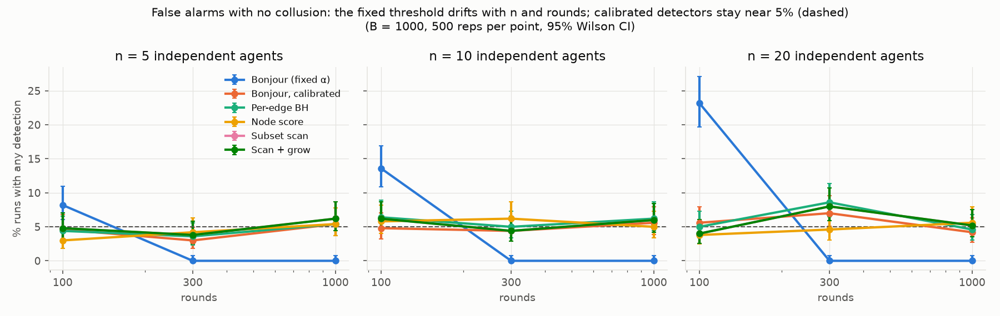

# Finding colluding groups from players' moves — experiment summary

For the Apart Research AI Collusion Research Sprint (2026-10-23 to 2026-10-25, America/Chicago),
research question 1.4.

## The problem and what we built

Players in a repeated game can secretly coordinate. An auditor sees only their moves. A 2022
method (Bonjour, Aggarwal & Bhargava, UAI 2022) flags two players who influence each other more
than anyone else influences them. It assumes exactly two colluders.

We asked one question: **can a search over groups of players find colluding groups that the
pairwise method misses?**

We built a simulator for Rock Paper Scissors with up to 20 players, with honest players and
planted colluding groups. We then compared six detectors on the same simulated games.

## Key terms

| Term | Meaning |
|------|----------------------------|
| n | Number of players in the game (5, 10 or 20). |
| Rounds | Number of times the game is played. More rounds give more evidence. |
| Collusion probability | Share of rounds in which the colluders coordinate. 0.2 = 20% of rounds; in other rounds they play randomly. Low values mean weak, hard-to-see collusion. |
| Link | How much two players' moves in the same round depend on each other (mutual information, in bits). |
| Shuffle test | We shuffle each player's moves across rounds. This keeps each player's habits but destroys coordination. A link or group counts as real only if it beats the shuffled versions. |
| History state | What honest players may react to from the previous round. The shuffle stays inside rounds with the same state. From coarse to fine: none, top (which move led), order (ranking of the three move counts), full (exact move counts). |
| Exact recovery | The detector reports exactly the planted group: no member missing, no extra player. |
| Clean recovery | Exact recovery, and the detector reports nothing else. |
| False alarm | The detector reports a group when no collusion exists. A well-calibrated detector does this in about 5% of games. |
| [a, b] | 95% confidence interval for a percentage. |

## The planted groups

| Name | How the colluders behave |
|------|----------------------------|
| Pair | A helper plays the move that loses to its partner, feeding the partner a point. |
| Two pairs | Two separate pairs. |
| Hub | One leader, two helpers. Each helper feeds the leader; the helpers never coordinate directly. |
| Triangle, 4-clique, 5-clique | 3, 4 or 5 players share a secret signal and all play the same move. |
| xor | Player C plays (A + B) mod 3. Every pair of these players looks independent; only the three together show the pattern. |

## The detectors

| Name used below | What it does |
|---------|----------------------------|
| Bonjour | The published rule: a pair passes a fixed score of 0.05 in both directions, and exactly one pair must pass. |
| Bonjour (calibrated) | The same rule, but the pass mark comes from the shuffle test. |
| Pair test | Tests every pair with the shuffle test and controls false discoveries (Benjamini & Hochberg 1995). A group = players joined by significant pairs. |
| Player score | Scores each player by its total link strength and flags the top players. Inspired by Rose et al. (2026); not their method. |
| Group scan (ours) | Scores every group of 2 or more players by the links inside it; reports the best group if it beats the shuffle test. Repeats on the remaining players. |
| Group scan + grow (ours) | Group scan, then adds any player with a significant link into the found group. |
| Triple scans (ours, Step 6) | Test every set of 3 players for any joint dependence ("total correlation") or for dependence that pairs cannot explain ("third-order part"). |

## Findings

1. **The published rule cannot see groups of 3 or more.** Inside a group, each member's partners
   cancel each other out in its score. It found 0% of triangles, cliques and hubs in every setting
   (Figure A, Table 3).
2. **The group scan finds weak, broad coalitions that pairwise methods miss.** With 20 players,
   100 rounds and a 5-player group colluding 20% of the time, the group scan found the exact group
   in 44% of games; the best other method found it in 6% (Figure C, Table 4).
3. **The player score gets worse as players are added; the group scan barely does.** For a
   triangle, the player score falls from 72% to 52% exact recovery between 5 and 20 players; the
   group scan falls from 77% to 72% (Figure B, Table 3).
4. **The group scan has two weak spots.** It splits hubs into one leader–helper pair; the grow step
   fixes this. It is also weaker than the pair test on one isolated weak pair in a short game,
   because it must search about a million groups (Table 4).
5. **The published rule's fixed pass mark is not calibrated.** With no collusion at all, it
   raised false alarms in up to 43% of games, depending on game length, players and history state.
   Every shuffle-calibrated detector stayed near 5% (Figure D, Tables 2 and 5).
6. **With honest players who react to history, the detector must account for what they react
   to.** A too-coarse history state makes honest players look like colluders (up to 100% false
   alarms). A fine state removes false alarms but needs more rounds (Figure E, Tables 6 and 7).
7. **Triple scans catch xor collusion, which every pairwise method misses** (80–100% vs chance
   level). No fixed-size test catches everything: a 4-player version of xor is invisible to triple
   scans (Table 8).

## Figures

The figure legends use the code names of the detectors: *Subset scan* = group scan,
*Per-edge BH* = pair test, *Node score* = player score.

### Figure A — Inside a group, the published score cancels while the links stay strong

5 players, collusion probability 0.5, 1000 rounds. **Left:** the published score for each ordered
pair (row player i, column player j). **Right:** link strength as a z-score against shuffled data.
Players 0–2 are the colluders; 3 and 4 are honest. **Read it:** inside the triangle the published
score is about 0 (it must reach 0.05 both ways to flag a pair), while the links score about 200.
In the hub, the score passes only from leader to helper, never back.

### Figure B — The player score loses power as players are added

Triangle (left) and 4-clique (right), averaged over all collusion probabilities and round counts
in Step 4 (200 shuffles). **Read it:** both lines start close at 5 players; by 20 players the
player score has dropped about 20 points, while the group scan has dropped about 5.

### Figure C — Weak, broad groups in short games

20 players, 100 rounds, 1000 shuffles, 100 games per point; bars are 95% intervals. **Read it:**
at collusion probability 0.2–0.3 the group scan (pink) and scan + grow (dark green) find the group
far more often than the pair test (teal) and player score (yellow). Both Bonjour lines sit at 0.

### Figure D — False alarms with no collusion

All players honest and random; 1000 shuffles, 500 games per point. The dashed line is the 5%
target. **Read it:** Bonjour's fixed rule (blue) gives 8–23% false alarms at 100 rounds and 0%
later; every shuffle-calibrated detector stays near 5%. The group scan and scan + grow overlap
because growth only runs after a detection.

### Figure E — False alarms depend on the history state

10 players, 1000 rounds, no colluders, 200 games per point. Each panel is a mix of honest players;
the x-axis is the history state the detector accounts for, coarse (none) to fine (full).
**Read it:** points near the dashed 5% line are well calibrated. With random players every state
works. Leader-reactive players need at least "top". Margin-reactive players need "full".

## How each experiment was run

- **Step 1 — reproduce the published method** (3 players). Our average scores match the paper's
  Figure 3, and confirm its scores are in bits. Our accuracy matches the paper's Table 2 only if
  the score accounts for the previous round's moves, which the paper does not state. One paper
  number stays unexplained (Table 1).
- **Step 2 — smallest failing case** (5 players: a triangle or a hub, plus 2 honest players).
  Shows the cancellation directly (Figure A).
- **Step 4 — planted groups, 5 to 20 players,** no history. Collusion probability 0.05–0.5,
  100–1000 rounds. Full grid with 200 shuffles per test; the most informative settings rerun with
  1000 shuffles and 100 games each.
- **Step 5 — honest players that react to history** (10 players). Honest types: random;
  "leader-reactive" (plays what beats last round's most common move); "margin-reactive" (same,
  only when that move led by 3 or more). Part A: no colluders. Part B: a triangle or 4-clique
  planted at collusion probability 0.3.
- **Step 6 — triple scans** vs the group scan, 5 to 20 players, 300–3000 rounds, 200 shuffles.

## Caveats

- Simulated Rock Paper Scissors with scripted players, not learned agents.
- Exact search stops at about 20 players (about a million groups).
- The pair test needed a fix. A shuffle-based p-value cannot go below 1 ÷ (shuffles + 1), so the
  test could never fire with 10 or more players. We now fit a gamma distribution to the shuffled
  values. Its error rates are within about ±5% of nominal for p below 0.05 and 0.01, and slightly
  too high far in the tail. Details: WRITEUP_NOTES.md.
- Table 3 pools games across settings, so its confidence intervals would be too narrow; we omit
  them there.

## Checks on the results

- **The group scan's 8% false alarms at 20 players and 300 rounds is not a bug.** We reran that
  setting on 3,000 fresh games: the group scan gave 5.1% [4.4, 6.0], against an expected 5.4%
  for this test design. Its p-values were evenly spread, as they should be. The original 500
  games are an unusual sample (about a 1-in-1,000 pattern), and the code treats real and shuffled
  data identically. Details: `results/investigate_scan_fpr/`, WRITEUP_NOTES.md.
- **The pair test runs slightly high:** 7.7% [6.8, 8.7] false alarms on those 3,000 games. This
  comes from the gamma-fit approximation of its p-values, which is a little too generous far in
  the tail. We report it as is.
- **The triple scans' false-alarm rates (Table 8) rest on 50–100 games per setting.** A larger
  rerun was skipped. They use the same calibration design that the check above confirmed.

---

## Appendix: data tables

All values are percentages of simulated games.

### Table 1 — Reproducing the published method (Step 1, 3 players, 1000 games per row)

**Compares:** our version of the published rule with the paper's reported accuracy.
**Columns:** *No state* = our score using no history; *27-state* = our score conditioned on the
previous round's three moves; *Paper* = the paper's Table 2. Each value = % of games where exactly
the true pair was flagged.
**Read it:** the 27-state column is close to the paper, so the paper most likely conditioned on
history.

| Collusion probability | Rounds | No state | 27-state | Paper |
|---|---|---|---|---|
| 0.3 | 100 | 80 | 40 | 37 |
| 0.3 | 300 | 97 | 76 | 71 |
| 0.3 | 500 | 100 | 93 | 90 |
| 0.4 | 100 | 98 | 63 | 58 |
| 0.4 | 300 | 100 | 98 | 96 |
| 0.1 | average of 100–1000 | 2 | 7 | ≈8 |
| 0.2 | 1000 | 58 | 49 | 24 (unexplained) |

### Table 2 — False alarms of the published fixed pass mark (Step 1, 3 honest players)

**Compares:** the fixed pass mark of 0.05 with a shuffle-calibrated pass mark, with no collusion.
**Columns:** *Fixed* = published rule, with no state or with the 27-state history; *Calibrated* =
same rule with the pass mark from the shuffle test. Each value = % of 1000 games with any pair
flagged.
**Read it:** the target is 5%. The fixed mark swings from 0% to 43%.

| Rounds | Fixed, no state | Fixed, 27-state | Calibrated |
|---|---|---|---|
| 100 | 8.5 | 43.4 | 5–6 |
| 300 | 0.3 | 19.2 | 5–6 |
| 1000 | 0.0 | 0.1 | 5–6 |

### Table 3 — Exact recovery by planted group and number of players (Step 4, 200 shuffles)

**Compares:** all six detectors on every planted group, at 5, 10 and 20 players.
**Columns:** one per detector. Each value = % of planted groups recovered exactly, averaged over
all collusion probabilities and round counts tried for that group (12–15 settings, 50–100 games
each).
**Read it:** higher is better. Watch how each column changes as players increase.

| Planted group | Players | Bonjour | Bonjour (cal.) | Pair test | Player score | Group scan | Scan + grow |
|---|---|---|---|---|---|---|---|
| Pair | 5 | 71 | 94 | 90 | 86 | 96 | 91 |
| Pair | 20 | 70 | 86 | 89 | 72 | 90 | 84 |
| Two pairs | 5 | 9 | 7 | 68 | 4 | 75 | 70 |
| Two pairs | 20 | 7 | 7 | 63 | 2 | 62 | 58 |
| Hub | 5 | 0 | 0 | 85 | 86 | 76 | 92 |
| Hub | 20 | 0 | 0 | 88 | 70 | 75 | 85 |
| Triangle | 5 | 0 | 0 | 66 | 72 | 77 | 74 |
| Triangle | 10 | 0 | 0 | 64 | 61 | 75 | 72 |
| Triangle | 20 | 0 | 0 | 62 | 52 | 72 | 68 |
| 4-clique | 5 | 0 | 0 | 56 | 62 | 65 | 63 |
| 4-clique | 10 | 0 | 0 | 49 | 54 | 63 | 61 |
| 4-clique | 20 | 0 | 0 | 48 | 46 | 61 | 57 |
| 5-clique | 10 | 0 | 0 | 46 | 58 | 64 | 62 |
| 5-clique | 20 | 0 | 0 | 46 | 52 | 62 | 59 |
| xor | 5–20 | 0 | 0 | 0 | 0 | 0 | 0 |

10-player rows for pair, two pairs and hub are in `figures/table_structure_by_n_ci.csv`.

### Table 4 — Where the group scan wins and loses most (Step 4 rerun, 20 players, 1000 shuffles)

**Compares:** the group scan with the two strongest other methods in single settings.
**Columns:** *Setting* = planted group, collusion probability, rounds. Detector columns = % of
100 games with exact recovery, with 95% interval.
**Read it:** the top five rows are weak, broad groups (scan wins). The last two are the scan's
weak spots.

| Setting | Group scan | Pair test | Player score | Scan + grow |
|--------------|-------|-------|-------|-------|
| 5-clique, 0.2, 100 rounds | 44 [35, 54] | 6 [3, 12] | 6 [3, 12] | 41 [32, 51] |
| 4-clique, 0.3, 100 rounds | 91 [84, 95] | 59 [49, 68] | 37 [28, 47] | 89 [81, 94] |
| 5-clique, 0.3, 100 rounds | 91 [84, 95] | 61 [51, 70] | 52 [42, 62] | 87 [79, 92] |
| 4-clique, 0.2, 300 rounds | 97 [92, 99] | 77 [68, 84] | 61 [51, 70] | 93 [86, 97] |
| Triangle, 0.2, 300 rounds | 91 [84, 95] | 68 [58, 76] | 35 [26, 45] | 87 [79, 92] |
| Hub, 0.2, 300 rounds | 36 [27, 46] | 56 [46, 65] | 3 [1, 8] | 64 [54, 73] |
| Two pairs, 0.3, 100 rounds | 36 [30, 43] | 50 [43, 56] | 2 [1, 4] | 35 [29, 42] |

### Table 5 — False alarms with no collusion (Step 4 rerun, 1000 shuffles, 500 games each)

**Compares:** how often each detector reports a group when every player is honest and random.
**Columns:** *Players*, *Rounds*, then % of games with any report, with 95% interval.
**Read it:** the target is 5%. Bonjour's fixed rule drifts; the others stay close. The 8–9% for
the group scan and pair test at 20 players and 300 rounds did not reproduce on fresh games for
the group scan (5.1%); see "Checks on the results".

| Players | Rounds | Bonjour | Bonjour (cal.) | Pair test | Player score | Group scan |
|---|---|---|---|---|---|---|
| 5 | 100 | 8 [6, 11] | 5 [3, 7] | 4 [3, 7] | 3 [2, 5] | 5 [3, 7] |
| 10 | 100 | 14 [11, 17] | 5 [3, 7] | 6 [5, 9] | 6 [4, 8] | 6 [4, 9] |
| 20 | 100 | 23 [20, 27] | 6 [4, 8] | 5 [3, 7] | 4 [2, 6] | 4 [3, 6] |
| 20 | 300 | 0 [0, 1] | 7 [5, 10] | 9 [6, 11] | 5 [3, 7] | 8 [6, 11] |
| 20 | 1000 | 0 [0, 1] | 4 [3, 6] | 5 [3, 7] | 6 [4, 8] | 5 [4, 8] |

All other settings (5 and 10 players at 300 and 1000 rounds): shuffle-calibrated detectors 3–6%.

### Table 6 — False alarms among honest players who react to history (Step 5 Part A)

**Compares:** the group scan's false alarms under four history states, for four mixes of honest
players. No colluders. 10 players, 1000 rounds, 200 games per cell.
**Columns:** *Honest players* = the mix; *none / top / order / full* = the history state the
detector accounts for, coarse to fine. Each value = % of games with any report.
**Read it:** about 5% means the state captures what the honest players react to. Values far
above 5% mean the state is too coarse, and honest reactions look like collusion.

| Honest players | none | top | order | full |
|---|---|---|---|---|
| All random | 4 | 4 | 2 | 6 |
| Half leader-reactive | 100 | 4 | 4 | 4 |
| Half margin-reactive | 92 | 45 | 30 | 6 |
| Leader + margin + random | 100 | 20 | 10 | 8 |

The other calibrated detectors behave the same way (see `step5/summary.txt`).

### Table 7 — Finding a planted group among history-reacting honest players (Step 5 Part B)

**Compares:** how often the group scan finds the planted group cleanly, under each history state.
Honest players: leader + margin + random mix. Collusion probability 0.3, 10 players, 200 games
per cell.
**Columns:** *Planted group*, *Rounds*, then the history state. Each value = % of games with
clean recovery (planted group found, nothing else reported).
**Read it:** "none" always fails because honest players get flagged too. Coarse states (top,
order) fail more as games get longer. "Full" is weaker in short games but best from 1000 rounds.

| Planted group | Rounds | none | top | order | full |
|---|---|---|---|---|---|
| Triangle | 300 | 4 | 92 | 86 | 57 |
| Triangle | 1000 | 0 | 90 | 93 | 98 |
| Triangle | 3000 | 0 | 42 | 61 | 93 |
| 4-clique | 300 | 2 | 96 | 95 | 72 |
| 4-clique | 1000 | 0 | 86 | 90 | 96 |
| 4-clique | 3000 | 0 | 34 | 59 | 95 |

### Table 8 — Triple scans vs the group scan (Step 6, 200 shuffles)

**Compares:** the two triple scans with the pairwise group scan.
**Columns:** *Planted group* and setting; then the range of results over 5–20 players and the
listed rounds (100 games per setting at 5 and 10 players, 50 at 20). What each value counts
depends on the row:

- *xor* and *triangle* rows: % of games where the planted triple was recovered exactly.
- *Pair* row: % of games whose first report contains the pair. A triple scan can only report
  triples, so this asks whether it at least points at the pair.
- *No collusion* row: % of games with any report (target 5%).

**Read it:** the third-order scan reacts to xor but not to a plain pair. That is what separates
group-level from pairwise coordination.

| Planted group | Group scan | Total-correlation scan | Third-order scan |
|-----------------|------|------|------|
| xor, prob. 0.3–1.0, 300–3000 rounds | 0–4 | 80–100 | 94–100 |
| Triangle, prob. 0.2–0.5, 300 rounds | 86–100 | 96–100 | 2–68 |
| Triangle, prob. 0.2–0.5, 1000–3000 rounds | 100 | 100 | 70–100 |
| Pair, prob. 0.3 (contains the pair) | 100 | 98–100 | 0–4 |
| No collusion (false alarm) | 3–7 | 4–12 | 4–10 |

On shuffled data both triple statistics follow theory: chi-square with 20 degrees of freedom for
total correlation, and 8 for the third-order part. False-alarm rates use 50–100 games per setting.

## Where things are

- **Figures** (shown above; each PNG has the CSV behind it): `results/figures/`.
- **Per-step outputs:** `results/step1/` to `results/step6/`, plus `results/step4_final/`.
- **Method notes, derivations, validation checks:** `results/WRITEUP_NOTES.md`.
- **Code:** `collusion/` (library), `experiments/` (one script per step), `tests/`.
