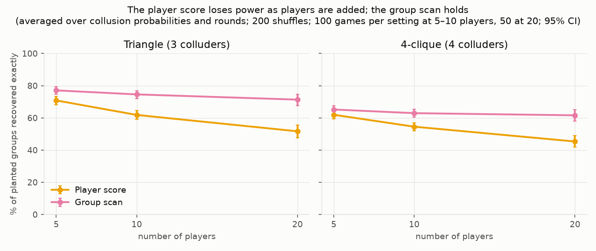

# Finding colluding groups from players' moves — simulation results

Apart Research AI Collusion Research Sprint (2026-10-23 to 2026-10-25), research question 1.4.
This file covers findings 1–3 of the [README](../README.md): simulated Rock Paper Scissors. The
LLM experiments (finding 4) are in [studies/llm_auction_5seller](../studies/llm_auction_5seller/README.md) and [studies/llm_auction_2seller](../studies/llm_auction_2seller/README.md).

## Question

Players in a repeated game can secretly coordinate, and an auditor sees only their moves. The
information-theoretic detector of Bonjour, Aggarwal & Bhargava (UAI 2022) flags two players who
influence each other more than anyone else influences them. It assumes exactly two colluders.
**Can a search over groups of players find colluding groups that this pairwise method misses,
without flagging honest players?**

## Setup

**Game.** n-player Rock Paper Scissors (n = 5, 10 or 20). Each round every player plays every
other: +1 for a win, −1 for a loss. Honest players are random unless stated otherwise. Colluders
sit at random seats. Each setting is run over many games (50–500), and we report the percentage
of games in which a detector gets it right.

**Planted groups.** In each round the colluders coordinate with a set probability (the
*collusion probability*); otherwise they play randomly.

| Group | What the colluders do |
|---|---|
| Pair, two pairs | A helper plays the move that loses to its partner, feeding the partner a point. |
| Hub | One leader, two helpers that each feed the leader and never coordinate with each other. |
| Triangle, 4-clique, 5-clique | 3–5 players share a secret signal and all play the same move. |
| xor | Player C plays (A + B) mod 3: every pair looks independent. |
| Steer | 4 players all play one move to create a clear lead, then all play the move that beats the honest players who react to that lead. |

Against random opponents no strategy wins on average. Pair and hub collusion moves points to one
player (rank boosting, as in Bonjour et al.). The triangle, cliques and xor are detection
benchmarks: a shared signal with no payoff motive. The steer group is the case where
coordination itself pays.

**Honest players who react to history.** *Leader-reactive* players play what beats last
round's most common move, with probability 0.5. *Margin-reactive* players do the same, but only
when that move led by 3 or more. *Exploiters* play the move that beats the leader-reactive
response, each on their own, without coordinating.

**Detectors.** All but Bonjour's published rule use the same shuffle test. Each player's moves
are shuffled across rounds, which keeps that player's habits but destroys coordination. A link
or group counts only if it beats 95% of the shuffled versions. With history-reacting players,
the shuffle stays within rounds that share the same *history state*: none, top (which move led
last round), order (ranking of last round's move counts) or full (exact counts).

| Detector | What it does |
|---|---|
| Bonjour | Published rule: a pair passes a fixed score of 0.05 in both directions, and exactly one pair must pass. |
| Bonjour (calibrated) | Same rule, with the pass mark taken from the shuffle test. |
| Pair test | Tests every pair, controlling false discoveries (Benjamini & Hochberg 1995); a group is players joined by significant pairs. |
| Player score | Scores each player by total link strength and flags the top players. Inspired by Rose et al. (2026); not their method. |
| **Group scan (ours)** | Scores every group of 2+ players by the links inside it and reports the best group if it beats the shuffle test; repeats on the remaining players. |

*Exact recovery* = the detector reports exactly the planted group. *Clean recovery* = exact
recovery and nothing else reported. *False alarm* = a report when no collusion exists; the
target is 5%. Brackets are 95% confidence intervals.

## Finding 1 — The pairwise method cannot see groups

Inside a group, each member's partners cancel each other out in its score, so the published rule
found **0% of triangles, cliques and hubs in every setting** (Figure A, Table 1). The links
themselves stay strong: about 200 standard deviations above the shuffled data inside a triangle.
Its fixed pass mark is also uncalibrated. With no collusion it raised false alarms in 8–23% of
100-round games and 0% of longer ones, and in up to 43% with history (Tables 3–4). Every
shuffle-calibrated detector stayed near 5%.

**Figure A.** 5 players, collusion probability 0.5, 1000 rounds; players 0–2 collude. Left: the
published score for each ordered pair (it must reach 0.05 both ways). Right: link strength as a
z-score against shuffled data. Inside the triangle the score is about 0 while the links are
about 200. In the hub the score passes only from leader to helper.

## Finding 2 — The group scan finds weak, broad groups

Scoring a group as a whole adds up evidence that is too weak in any single pair. With 20
players, 100 rounds and a 5-player group colluding 20% of the time, the group scan found the
exact group in **48% of games, against 5% for the best other method** (Figure C, Table 2). It
also holds up as players are added. For a triangle, the player score falls from 71% to 52% exact
recovery between 5 and 20 players, while the group scan falls from 77% to 71% (Figure B, Table 1).

**Figure C.** 20 players, 100 rounds, 1000 shuffles, 100 games per point. At collusion
probability 0.2–0.3 the group scan finds the group far more often than the pair test or the
player score; Bonjour stays at 0.

**Figure B.** Triangle and 4-clique, averaged over all collusion probabilities and round counts
(200 shuffles). By 20 players the player score has lost about 20 points; the group scan, about 5.

**Weak spots.** The group scan often reports a hub as one leader–helper pair, because the two
helpers are not linked to each other. The pair test, which joins both edges, does better there
(58% vs 34% at collusion probability 0.2 and 300 rounds). The pair test also wins narrowly on
two separate weak pairs in a short game (58% vs 52%), because the group scan pays for searching
about a thousand groups at 10 players (Table 2).

**Very large groups.** With 18 of 20 players colluding, the group scan recovers the exact group in
96–100% of games from collusion probability 0.2 (300 rounds) or 0.3 (100 rounds). The player score keeps
up at weak collusion (76–100% at 0.1 with 300 rounds and at 0.2) but levels off at 76–92% at 0.3–0.5;
the pair test stays at 32–42% from 0.1 (300 rounds) up. Details: `large_group/summary.txt`.

## Finding 3 — The test must condition on what honest players react to

Honest players who react to last round's moves are correlated with each other. If the shuffle
ignores that history, they look like colluders: **up to 100% false alarms** (Figure E, Table 5).
Conditioning on a state that captures what they react to brings false alarms back to about 5%.
Leader-reactive players need at least "top"; margin-reactive players need "full". A finer state
costs power in short games: a planted triangle among reactors is found cleanly in 50% of
300-round games with "full", rising to 94–95% from 1000 rounds (Table 6).

The same holds when collusion pays. A steer group earns **0.21 points per round each, 2.6 times
what four exploiters earn** reacting to the same lead on their own, and the margin-reactive
players pay for it. With the full state, the group scan finds the steer group cleanly in 94–98%
of games of 1000+ rounds when it colludes 20–30% of the time. **The honest exploiters are
flagged in only 4–7% of games.** With coarser states the exploiters look like colluders as
games get longer: 66–71% under "top" and 96–100% with no state at 3000 rounds (Table 7).

**Figure E.** 10 players, 1000 rounds, no colluders, 200 games per point. Each panel is a mix of
honest players; the x-axis is the history state, coarse to fine. The dashed line is the 5%
target.

## Limits

- **Collusion with no pairwise trace is invisible.** In xor every pair of colluders looks
  independent, so every method here finds 0% (Table 1). A test of all triples catches this case,
  but the same construction with 4 players leaves every triple independent too, so no
  fixed-size test generalizes. We leave higher-order collusion open.
- **Scripted players.** The agents follow fixed rules; the LLM experiment (finding 4) tests real
  agents.
- **Exact search stops at about 20 players** (about a million groups).
- **The history state must be chosen.** The test is only as good as the recorded state; it
  cannot detect that honest players react to something unrecorded.
- **The pair test runs slightly high:** 7.7% [6.8, 8.7] false alarms on 3,000 fresh null games
  (20 players, 300 rounds). Its p-values come from a gamma fit to the shuffled values (a plain
  shuffle p-value cannot go low enough to pass its correction at 10+ players), and that fit is a
  little too generous far in the tail.

## Checks

- **Reproducing the published method** (3 players). Our average scores match the paper's
  Figure 3 in bits. Our accuracy matches its Table 2 only if the score conditions on the previous
  round's moves, which the paper does not state. One paper number stays unexplained (Table 8).
- **The group scan's 8% false alarms at 20 players and 300 rounds** (Table 3) did not reproduce
  on 3,000 fresh games: 5.1% [4.4, 6.0], against 5.4% expected for this test design, with evenly
  spread p-values. Details: `investigate_scan_fpr/`, `WRITEUP_NOTES.md`.

---

## Data tables

All values are percentages of simulated games.

### Table 1 — Exact recovery by planted group and number of players

200 shuffles. Each value is averaged over all collusion probabilities and round counts tried for
that group (12–15 settings at 50–100 games each, 4 settings for pair, hub and xor). Pooled
intervals would be too narrow, so none are shown; 10-player rows for pair, two pairs and hub are
in `figures/table_structure_by_n_ci.csv`.

| Planted group | Players | Bonjour | Pair test | Player score | Group scan |
|---|---|---|---|---|---|
| Pair | 5 | 72 | 91 | 86 | 96 |
| Pair | 20 | 70 | 89 | 72 | 91 |
| Two pairs | 5 | 8 | 69 | 4 | 74 |
| Two pairs | 20 | 7 | 63 | 3 | 62 |
| Hub | 5 | 0 | 89 | 87 | 75 |
| Hub | 20 | 0 | 86 | 68 | 78 |
| Triangle | 5 | 0 | 67 | 71 | 77 |
| Triangle | 10 | 0 | 64 | 62 | 75 |
| Triangle | 20 | 0 | 64 | 52 | 71 |
| 4-clique | 5 | 0 | 56 | 62 | 65 |
| 4-clique | 10 | 0 | 49 | 55 | 63 |
| 4-clique | 20 | 0 | 48 | 45 | 62 |
| 5-clique | 10 | 0 | 46 | 58 | 65 |
| 5-clique | 20 | 0 | 46 | 51 | 63 |
| xor | 5–20 | 0 | 0 | 0 | 0 |

### Table 2 — Where the group scan wins and loses

20 players unless noted, 1000 shuffles, 100 games per row (two pairs: 2 pairs in each of 100 games). Exact recovery.

| Setting (group, collusion prob., rounds) | Group scan | Pair test | Player score |
|---|---|---|---|
| 5-clique, 0.2, 100 | 48 [38, 58] | 5 [2, 11] | 4 [2, 10] |
| 4-clique, 0.3, 100 | 91 [84, 95] | 54 [44, 63] | 36 [27, 46] |
| 5-clique, 0.3, 100 | 93 [86, 97] | 58 [48, 67] | 62 [52, 71] |
| 4-clique, 0.2, 300 | 96 [90, 98] | 76 [67, 83] | 61 [51, 70] |
| Triangle, 0.2, 300 | 92 [85, 96] | 71 [61, 79] | 31 [23, 41] |
| Hub, 0.2, 300 | 34 [25, 44] | 58 [48, 67] | 1 [0, 5] |
| Two pairs, 0.3, 100 (10 players) | 52 [46, 59] | 58 [51, 64] | 4 [2, 8] |

### Table 3 — False alarms with no collusion

All players random; 1000 shuffles, 500 games per row. Other settings (5 and 10 players at 300
and 1000 rounds): shuffle-calibrated detectors 3–6%.

| Players | Rounds | Bonjour | Bonjour (cal.) | Pair test | Player score | Group scan |
|---|---|---|---|---|---|---|
| 5 | 100 | 8 [6, 11] | 5 [3, 7] | 4 [3, 7] | 3 [2, 5] | 5 [3, 7] |
| 10 | 100 | 14 [11, 17] | 5 [3, 7] | 6 [5, 9] | 6 [4, 8] | 6 [4, 9] |
| 20 | 100 | 23 [20, 27] | 6 [4, 8] | 5 [3, 7] | 4 [2, 6] | 4 [3, 6] |
| 20 | 300 | 0 [0, 1] | 7 [5, 10] | 9 [6, 11] | 5 [3, 7] | 8 [6, 11] |
| 20 | 1000 | 0 [0, 1] | 4 [3, 6] | 5 [3, 7] | 6 [4, 8] | 5 [4, 8] |

### Table 4 — The published fixed pass mark with history (3 random players)

1000 games per row; % with any pair flagged. *27-state* = the score conditioned on the previous
round's three moves.

| Rounds | Fixed, no state | Fixed, 27-state | Calibrated |
|---|---|---|---|
| 100 | 8.5 | 43.4 | 5–6 |
| 300 | 0.3 | 19.2 | 5–6 |
| 1000 | 0.0 | 0.1 | 5–6 |

### Table 5 — False alarms among honest players who react to history

Group scan, 10 players, 1000 rounds, no colluders, 200 games per cell. The other calibrated
detectors behave the same way (`step5/summary.txt`).

| Honest players | none | top | order | full |
|---|---|---|---|---|
| All random | 4 | 4 | 2 | 6 |
| Half leader-reactive | 100 | 4 | 6 | 9 |
| Half margin-reactive | 94 | 47 | 30 | 4 |
| Leader + margin + random | 100 | 16 | 10 | 4 |

### Table 6 — Finding a planted group among honest players who react to history

Group scan, clean recovery. Leader + margin + random honest players, collusion probability 0.3,
10 players, 200 games per cell. With no state, honest players are always flagged too.

| Planted group | Rounds | none | top | order | full |
|---|---|---|---|---|---|
| Triangle | 300 | 4 | 95 | 86 | 50 |
| Triangle | 1000 | 0 | 90 | 92 | 94 |
| Triangle | 3000 | 0 | 41 | 68 | 95 |
| 4-clique | 300 | 2 | 92 | 91 | 70 |
| 4-clique | 1000 | 0 | 90 | 92 | 93 |
| 4-clique | 3000 | 0 | 34 | 56 | 94 |

### Table 7 — Profitable collusion: steer group vs honest exploiters

4 steer colluders, or 4 exploiters reacting at the same rate on their own, among 3
margin-reactive and 3 random players; 200 games per cell. *Payoff* = mean points per round for
each of the 4 (the margin-reactive players' payoff in brackets), averaged over 300–3000 rounds.
Recovery and false alarms are for the group scan with the full state, at 300 / 1000 / 3000
rounds.

| Collusion prob. | Steer payoff | Exploiter payoff | Steer clean recovery | Exploiter false alarms |
|---|---|---|---|---|
| 0.1 | 0.08 (−0.11) | 0.03 (−0.04) | 7 / 84 / 95 | 6 / 6 / 7 |
| 0.2 | 0.15 (−0.20) | 0.06 (−0.07) | 76 / 98 / 94 | 5 / 4 / 6 |
| 0.3 | 0.21 (−0.27) | 0.08 (−0.10) | 92 / 94 / 94 | 5 / 6 / 6 |

At 3000 rounds the group scan flags the exploiters in 66–71% of games under "top", 40–50% under
"order" and 96–100% with no state. All detectors and states: `step5/partC_detection_ci_n10.csv`.

### Table 8 — Reproducing the published method (3 players, 1000 games per row)

% of games where exactly the true pair was flagged. *No state* / *27-state* = our score without
history / conditioned on the previous round's three moves; *Paper* = Bonjour et al., Table 2.

| Collusion prob. | Rounds | No state | 27-state | Paper |
|---|---|---|---|---|
| 0.3 | 100 | 80 | 40 | 37 |
| 0.3 | 300 | 97 | 76 | 71 |
| 0.3 | 500 | 100 | 93 | 90 |
| 0.4 | 100 | 98 | 63 | 58 |
| 0.4 | 300 | 100 | 98 | 96 |
| 0.1 | average of 100–1000 | 2 | 7 | ≈8 |
| 0.2 | 1000 | 58 | 49 | 24 (unexplained) |

## Where things are

- Figures and the CSV behind each: `figures/`. Figure D (false alarms vs rounds with no
  collusion) is there too, with the data in Table 3.
- Per-step outputs: `step1/` (reproduction), `step2/` (Figure A), `step4/` and `step4_final/`
  (planted groups), `step5/` (history), `investigate_scan_fpr/`.
- Commands and seeds for every number: `RESULTS_INDEX.md`. Method notes: `WRITEUP_NOTES.md`.
