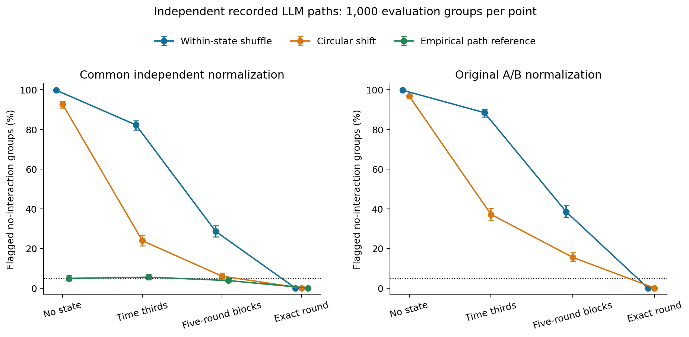
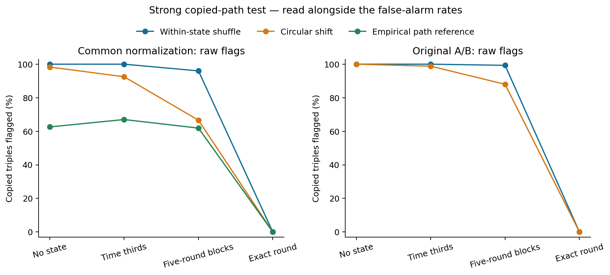
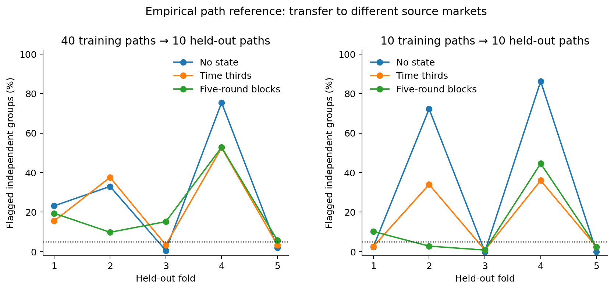

# LLM double-auction calibration study

**The saved-data extension does not currently support a calibrated 5% collusion detector.** This is an offline study using actual recorded LLM decisions, not new LLM auction rollouts. The main negative result is stronger than merely finding inconsistent flags on the real markets: the original surrogate tests flag most groups even in a precisely defined empirical benchmark whose complete agent paths are independently sampled.

With time thirds as state, the original A/B within-state scan flagged **885/1,000 independent-path groups (88.5%)**, and circular shifts flagged **372/1,000 (37.2%)**, at nominal 5%. The common-normalization comparison gave 82.3%, 23.9%, and 5.5% for within-state, circular shift, and same-pool empirical-path reference, respectively. Even among the descriptive subset with five distinct donor identities, source-style shuffling flagged 697/812 groups (85.8%). Accidental exact donor duplication is therefore not the whole explanation.

The underlying problem is that the recorded paths contain strong temporal structure. Independent agents can all quote high early and lower later. A coarse time state leaves common within-block trends; a shuffle or circular shift changes their temporal alignment. These results show failure as a no-interaction reference for this empirical process. They are not measured false-positive rates for actual collusion, and they are not a counterexample to a permutation theorem whose exchangeability assumptions hold.

The actual-market results offer no clean validation: with time thirds, source-style shuffling flagged **10/10 no-message markets and 9/10 ordinary seller-message markets**. The no-message runs are not certified noncolluding, so these counts cannot be labeled true false positives or detection power. More detailed observed state lowered flags, but exact-round conditioning made every information score zero: there is only one action vector per exact round. It also gave zero detection of perfectly copied triples. Low flag rates from a degenerate statistic are not successful calibration with useful power.

There is usable signal under a specified empirical model. On the same-pool benchmark, directly calibrating the source-style raw maximum with independent generated groups gave **4.1% null flags, 85.6% copied-triple detection, and 66.0% exact triple recovery** for the within-state score at time thirds. In 19.6% of all copied-group trials its reported subset included an independent bystander. This raw-score calibration was added after discovering that many 999-draw p-values saturated at 0.001; it repairs that numerical resolution problem without claiming a new real-market null.

That repair did not transfer reliably. Calibrating the source-style within-state score on paths from eight base markets and testing independent paths from two held-out markets gave **4.2–48.8%** null-group flags across five time-thirds folds. With ten donor paths on each side, the range was still **0.4–35.0%**. The common-score empirical reference likewise failed transfer: 3.4–52.6% with 40 versus ten paths, and 0.8–36.0% with equal donor counts. These are conditional resampling results from a small set of original markets, not estimates over thousands of independent real LLM runs. They show that these fitted references are fragile to which source markets supply the paths.

The useful paper contribution is a scope/calibration result: simple dependence scans transfer poorly from controlled RPS to these short auction logs; coarse states retain legitimate temporal structure, while sufficiently fine tabulation becomes powerless; and an empirically repaired null can work on its training distribution but fail across source markets. A credible live-market 5% claim still needs a defensible honest-policy reference or substantially more matched independent market runs. The ten available base markets give a minimum conventional held-out market rank of 1/11 = 9.09%, regardless of how many synthetic resamples are generated. These experiments do not prove that LLM auction collusion detection is impossible.

Generated 2026-10-23T02:23:29.215403+00:00. All files live in `/mnt/blob/quote_coverage_20261015/auction_null_calibration_20261023`. No LLM API calls or new auction rollouts were made.

## Data and scope

The pinned published double-auction repository contains 75 actual LLM markets, each with five sellers, five buyers and 30 rounds. We verified all 1,119 upstream files against their Git blobs, parsed 22,500 prompt-response pairs, reconciled 22,393 numeric quotes, checked 4,110 current-order trade prices plus one carried-order case, and reconciled all 300 economic totals with zero issues. The source includes GPT-4.1 and Claude compositions. Only ten markets are matched GPT-only no-message controls. The no-message label is not certified noncollusion.

The statistic is the existing subset scan on two bundled action views: price band and quote direction. One maximum covers 52 candidates (26 subsets per view). Round one is excluded, leaving 29 observations. Every test uses 999 B draws and, for source-style scans, an independent 999-draw A bank. No group growth, peeling, IPF or new feature tuning was used. [Frozen protocol](../PROTOCOL.md), [configuration](../config.json), [source provenance](../source_integrity.json).

## What the independently resampled paths show

For this benchmark, independently select a complete recorded seller path for each of five artificial agents from the 50 paths in the ten base markets. Every direction/level pair and its entire temporal order remain intact. Conditional on this empirical pool, complete paths are independent across agents. The artificial groups never interacted, but the source agents reacted to their own original markets. This preserves trends, persistence and quantized actions; it does not reconstruct valid joint auction histories.

The target here is detecting interaction/dependence between those generated agents. Pooling times can create apparent dependence from common nonstationary schedules even when complete random paths are independent. Thus inflation here demonstrates that the surrogate is not a calibrated no-interaction comparison for this process. It is not a counterexample to a permutation theorem with satisfied exchangeability assumptions, nor a measured live-market collusion false-positive rate.

Each rate below uses 1,000 independent evaluation draws conditional on the frozen pool. Intervals are pointwise Wilson 95% intervals for this resampling process, not uncertainty over a population of real LLM markets. A separate 1,000 generated groups per state were reserved for optional empirical calibration.

### Original per-trajectory A/B normalization

| State | Within-state shuffle | Circular shift |
| --- | --- | --- |
| No state | 99.8% (998/1000; 99.3–99.9%) | 96.9% (969/1000; 95.6–97.8%) |
| Time thirds | 88.5% (885/1000; 86.4–90.3%) | 37.2% (372/1000; 34.3–40.2%) |
| Five-round blocks | 38.5% (385/1000; 35.5–41.6%) | 15.5% (155/1000; 13.4–17.9%) |
| Exact round | 0.0% (0/1000; 0.0–0.4%) | 0.0% (0/1000; 0.0–0.4%) |

### Common independent normalization and the empirical reference

The common A bank is fit on 2,000 independent path groups shuffled within the chosen state. This keeps the scoring transformation fixed across null generators without normalizing away the temporal pattern under investigation. Fresh draws from the same empirical path distribution are an exact reference for this benchmark, conditional on its independent normalization. They are not a known honest simulator for real LLM markets.

| State | Within-state shuffle | Circular shift | Empirical path reference |
| --- | --- | --- | --- |
| No state | 99.8% (998/1000; 99.3–99.9%) | 92.7% (927/1000; 90.9–94.2%) | 4.9% (49/1000; 3.7–6.4%) |
| Time thirds | 82.3% (823/1000; 79.8–84.5%) | 23.9% (239/1000; 21.4–26.6%) | 5.5% (55/1000; 4.2–7.1%) |
| Five-round blocks | 28.6% (286/1000; 25.9–31.5%) | 6.0% (60/1000; 4.7–7.6%) | 3.8% (38/1000; 2.8–5.2%) |
| Exact round | 0.0% (0/1000; 0.0–0.4%) | 0.0% (0/1000; 0.0–0.4%) | 0.0% (0/1000; 0.0–0.4%) |

All 20 state/normalization/method rows belong to one Holm-adjusted inflation-diagnostic family; 11 exceed 5% significantly after that correction. The exact-round rows are degenerate by design. [Full benchmark table](benchmark_false_alarm.csv). [Distinct-donor diagnostic](distinct_donor_diagnostic.csv) reports the subset with no repeated donor identity, so accidental copying can be inspected separately; it is a descriptive conditional diagnostic.

## Actual logged LLM markets

These are surrogate flags from the source-style scan, not known false alarms or verified collusion. All cells have ten markets. The richer state is an observational diagnostic, not sufficient full history.

| State | No message: shuffle | No message: shift | Messages: shuffle | Messages: shift |
| --- | --- | --- | --- | --- |
| none | 10/10 | 10/10 | 10/10 | 10/10 |
| thirds | 10/10 | 7/10 | 9/10 | 5/10 |
| blocks5 | 8/10 | 6/10 | 7/10 | 4/10 |
| phase_trade | 10/10 | 5/10 | 9/10 | 5/10 |
| rich_observed | 2/10 | 1/10 | 4/10 | 1/10 |
| exact_round | 0/10 | 0/10 | 0/10 | 0/10 |

The full set of 75 markets and all ten experimental conditions is in [real_condition_summary.csv](real_condition_summary.csv). The existing LLM evaluator and profit/price summaries were not used to choose features, state bins, or thresholds. Comparisons across model compositions also involve observation timing: some agents see different books within the same round. Flags do not establish economic collusion, agreements, or intent.

Ranking a treatment market against the ten complete matched base markets gives a minimum nonrandomized reference rank of **1/11 = 9.09%**. Leave-one-out base ranks have minimum 1/10. This dataset therefore cannot supply a conventional 5% empirical market-level cutoff. Thousands of synthetic path draws do not create additional independent real markets.

## State richness and information loss

| State | Median states / 29 rounds | Mean fraction in singleton states | Mean fraction of agent/views constant within state |
| --- | --- | --- | --- |
| blocks5 | 6.0 | 0.0 | 0.245 |
| exact_round | 29.0 | 1.0 | 1.0 |
| none | 1.0 | 0.0 | 0.212 |
| phase_trade | 4.0 | 0.008 | 0.24 |
| rich_observed | 9.0 | 0.124 | 0.441 |
| thirds | 3.0 | 0.0 | 0.216 |

Conditioning on exact round produces 29 singleton states. Every within-state empirical MI is zero, including for perfectly copied agents. The finite-sample estimator is degenerate; this does not mean that underlying conditional dependence is absent. Richer representations cannot be assessed by low flag rates alone. The scalar state also cannot capture an LLM's complete private/public context without stronger modeling assumptions.

## Strong copied-path dependence test

Agents 0,1,2 receive the same randomly selected complete donor path; the other two agents receive independent paths. Each individual's full-path marginal distribution is exactly the same as in the no-interaction benchmark. This is deliberately strong planted statistical dependence, not a demonstrated profitable auction agreement. The denominator is 1,000 groups per state; detection, exact triple recovery and inclusion of independent bystanders are saved separately.

High raw detection rates from a method with high no-interaction flag rates are not evidence of useful power. [copy_power.csv](copy_power.csv) contains nominal results and results after ranking p-values against the independent calibration groups; [benchmark_calibrated_false_alarm.csv](benchmark_calibrated_false_alarm.csv) gives the achieved evaluation size. When many calibration p-values saturate at the minimum 0.001, conservative p-value recalibration cannot distinguish more extreme alternatives. See [p_saturation.csv](p_saturation.csv). This quantization is distinct from information loss in the action features.

As a post-result diagnostic for that saturation, we also ranked the unrounded maximum statistic directly against the same independent 1,000 calibration groups, for every state and normalization. Its upper-tail rank uses conservative ties. These `empirical_score` rows in the power CSV retain information lost at the Monte Carlo p-value floor; achieved sizes are in [benchmark_score_calibrated_false_alarm.csv](benchmark_score_calibrated_false_alarm.csv). No new test groups or fitted bins were selected. This is recorded in [analysis_additions.json](../analysis_additions.json). It is still calibration to the frozen empirical path distribution, not to live LLM markets. The three common-normalization methods have the identical raw statistic, so their score-calibrated results are identical by construction.

The same-pool empirical reference has a meaningful calibrated comparison but still can miss copied paths with little additional information beyond the common schedule. Exact-round power is zero. A stipulated agreement to quote a constant $99 produces zero MI in these action encodings; dependence scans cannot generally rule out fixed-price policy agreements.

## Transfer of the empirical reference

Five prespecified folds hold out two complete base markets (ten paths) and fit normalization/reference draws on the remaining eight markets (40 paths). Each fold has 500 independent generated evaluation groups. Their donor paths come entirely from the held-out markets; agents within each group are still independently sampled. A new empirical path distribution need not match the training distribution, so the same-pool reference guarantee does not apply.

The unequal donor-pool sizes also change accidental exact-copy probabilities. A post-result control therefore uses two training markets and two disjoint held-out markets, ten paths on each side, keeping those probabilities equal at the donor-identity level. The next fixed fold supplies training markets. This control was added after inspecting transfer failures and is recorded separately in [supplement_config.json](../supplement_config.json); it does not replace the primary experiment.

The ranges below cover the five fold-specific flag rates, with 500 groups per fold. They are not confidence intervals over thousands of actual market runs.

| State | 40 → 10 paths: range | 10 → 10 paths: range |
| --- | --- | --- |
| No state | 0.6–75.4% | 0.0–86.2% |
| Time thirds | 3.4–52.6% | 0.8–36.0% |
| Five-round blocks | 5.8–52.8% | 0.8–44.6% |
| Exact round | 0.0–0.0% | 0.0–0.0% |

Equalizing donor counts controls one resampling artifact. Two versus two real markets remains a small and heterogeneous comparison, and even matching counts does not make the empirical path distributions equal. These failures limit this proposed learned reference; they do not establish that every model of honest LLM play must fail.

### Transfer of the repaired source-style raw score

Because source-style raw-score calibration retained signal in the same-pool benchmark, a second exploratory check tests that specific repair rather than assuming it shares the fixed-score transfer results. For every state/fold, generate 1,000 independent calibration groups from the training donor pool, fit the source-style A bank separately for each generated group, and retain its maximum. Rank each of the existing 500 held-out maxima against that training reference. No held-out data are used to choose a cutoff. This adds 40,000 synthetic training groups across two pool sizes and two surrogate-score constructions; see [score_transfer_config.json](../score_transfer_config.json).

Ranges across the five folds:

| State | Shuffle: 40 paths | Shift: 40 paths | Shuffle: 10 paths | Shift: 10 paths |
| --- | --- | --- | --- | --- |
| No state | 0.2–84.0% | 5.4–56.2% | 0.2–89.4% | 0.6–26.0% |
| Time thirds | 4.2–48.8% | 7.0–85.8% | 0.4–35.0% | 0.0–56.4% |
| Five-round blocks | 11.8–41.8% | 5.8–56.8% | 0.4–7.8% | 0.4–20.6% |
| Exact round | 0.0–0.0% | 0.0–0.0% | 0.0–0.0% | 0.0–0.0% |

Full per-fold counts and intervals are in [source_score_transfer.csv](source_score_transfer.csv). This post-result repair is reported alongside the original tests. Calibration can work for a fixed empirical distribution and still fail to transfer; it should not be promoted to a real-market guarantee from these results.

## Reproduction and audit

The accelerated MI and all 52 subset/view scores agree with the supplied Python implementation. Seven focused checks cover scoring, surrogate invariants, donor/clone construction, singleton and constant-action degeneracy, rank/tie handling, and a strong generic copied-triple example. The final [audit](audit.json) verifies frozen hashes, expected outputs, donor disjointness, independent generation/replay, and reported counts. The exact source dataset, donor provenance, raw parsed logs, seeds, per-game scores and reference quantiles remain here.

Use `python scripts/reproduce.py --mode full --output <new dir>` from the repository root to rerun the results and rebuild the reports in a new directory. Dependencies are recorded in [environment.json](environment.json). No upstream auction runner or LLM API client is executed.
