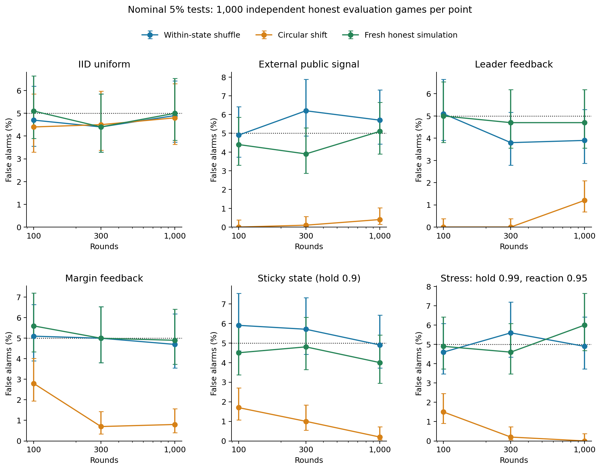
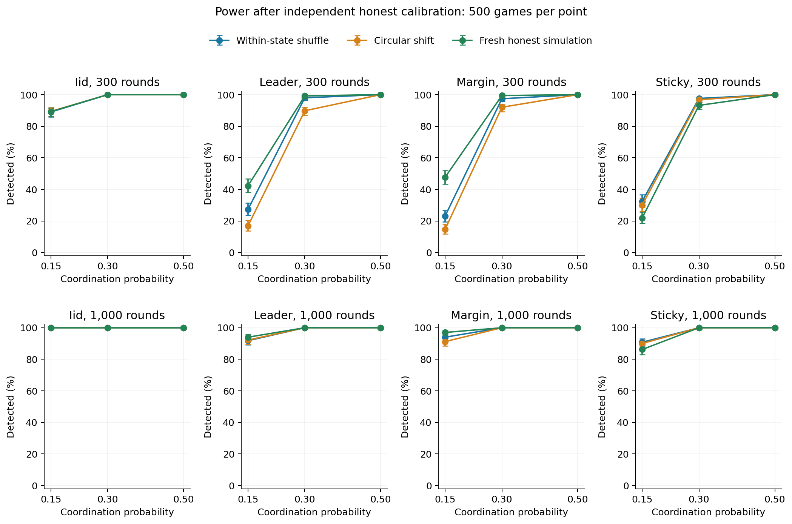

# Null-calibration experiment results

The central result is that **the tested honest adaptation did not produce evidence of inflated false alarms when the recorded state was sufficient**. With the common, independently fitted normalization, within-state false alarms ranged from 3.7% to 6.2% across the sufficient-state settings. The source-style A/B check ranged from 3.2% to 6.1% for within-state shuffling. No sufficient-state setting showed significant inflation after the prespecified multiple-comparison corrections. These are empirical results for the specified processes, not a theorem covering arbitrary adaptation.

The original detector remains highly sensitive to missing history. In six-agent, 300-round leader-reactive games, the source-style within-state scan falsely detected a coalition in **999/1,000 games without history (99.9%)**, versus **44/1,000 with full state (4.4%; 95% interval 3.3–5.9%)**. Top-only state for margin-reactive agents also inflated the source-style test (75/1,000; adjusted inflation p=0.0082). This supports adequate conditioning as a practical requirement.

Whole-column circular shifts were generally very conservative in the sufficiently conditioned reactive environments. For example, at 1,000 rounds in ordinary leader feedback, the common-normalization false-alarm rates were 3.9% for within-state, 1.2% for circular shifts, and 4.7% for fresh simulation. Preserving the cyclic order of each agent's actions did not preserve the action/state relationship. Circular shifts should not be presented as an automatic correction for temporal dependence.

Power remained high for within-state shuffling. With 300-round leader feedback and a 30% shared-draw coordination probability, independent empirical calibration gave detection rates of **98.0% (490/500)** for within-state, **89.8% (449/500)** for circular shifts, and **99.2% (496/500)** for fresh simulation. The corresponding measured honest evaluation rates were **2.7%, 4.1%, and 4.3%**, so these are separately calibrated operating points rather than exactly equal measured sizes. Before that empirical recalibration, circular-shift detection was only 33.2%. Exact first-group recovery was 89.0%, 83.2%, and 89.4%, respectively; within-state detections included an innocent member in 12/500 games (2.4%). A significant maximum is a weaker result than exact coalition membership.

The normalization distinction matters. The main comparison intentionally gives all three methods a score normalized using an independent bank of known honest games. In an omitted-state setting, that bank already contains the honest dependence. The no-history leader false-alarm rate was only 5.7% with that normalization, despite 99.9% under source-style A/B normalization. Thus the main omitted-state rows must not be interpreted as showing that the original detector can dispense with history. The fixed normalization is useful for isolating a null-generator comparison, and the source-style sensitivity is necessary for conclusions about the existing implementation.

For the paper, this supports a calibration/robustness result: the adequate-state subset scan behaved well across these honest feedback and persistence regimes; omitting policy-relevant state was harmful; circular shifts often sacrificed sensitivity; and detection did not guarantee exact membership. The experiment did not establish the hypothesized general failure of within-state shuffling under honest adaptation. The fresh-simulation guarantee relies on known, correctly specified honest policies. There were no LLM or auction-data runs in this study. See [the statistical notes](../STATISTICAL_NOTES.md) for the oracle rank-test argument and the limits of the temporal-dependence claim.

Generated 2026-10-22T22:56:01.893024+00:00. All experiments and new files are under `/mnt/blob/quote_coverage_20261015/null_calibration_20261022`. The supplied repository is unchanged.

## Scope and denominators

25 settings, each with 2,000 independent games for normalization, 1,000 independent honest calibration games, and 1,000 separate honest evaluation games. Each method generates 999 new reference games per trajectory. The power study has 24 cells, each with 500 coordinated games. The source-style sensitivity uses 11 settings with 1,000 additional honest games each. There are no LLM runs.

The primary statistic scans all 57 subsets of size at least two among six agents. The ten-agent diagnostic scans 1,013 subsets. Counts below refer to the first detection in an entirely honest population. They do not establish strong family-wise error control under partial alternatives or correct membership after iterative removal.

The main comparison holds a single, independently fitted honest-simulation normalization fixed across null methods. The source-style sensitivity below restores per-trajectory, method-specific normalization. All use rank p-values and consistent float64 arithmetic, with conservative tie handling. Full definitions and frozen decisions are in [PROTOCOL.md](../PROTOCOL.md) and [config.json](../config.json).

## Nominal false alarms at 300 rounds

Each cell gives percent, count/1,000, and a Wilson 95% interval. The requested nominal rate is 5%.

| Setting | Within-state shuffle | Circular shift | Fresh honest simulation |
| --- | --- | --- | --- |
| iid_r300 | 4.4% (44/1000; 3.3–5.9%) | 4.5% (45/1000; 3.4–6.0%) | 4.4% (44/1000; 3.3–5.9%) |
| exogenous_r300 | 6.2% (62/1000; 4.9–7.9%) | 0.1% (1/1000; 0.0–0.6%) | 3.9% (39/1000; 2.9–5.3%) |
| leader_r300 | 3.8% (38/1000; 2.8–5.2%) | 0.0% (0/1000; 0.0–0.4%) | 4.7% (47/1000; 3.6–6.2%) |
| margin_r300 | 5.0% (50/1000; 3.8–6.5%) | 0.7% (7/1000; 0.3–1.4%) | 5.0% (50/1000; 3.8–6.5%) |
| sticky_r300 | 5.7% (57/1000; 4.4–7.3%) | 1.0% (10/1000; 0.5–1.8%) | 4.8% (48/1000; 3.6–6.3%) |
| sticky_strong_r300 | 5.6% (56/1000; 4.3–7.2%) | 0.2% (2/1000; 0.1–0.7%) | 4.6% (46/1000; 3.5–6.1%) |

## Nominal false alarms at 1,000 rounds

| Setting | Within-state shuffle | Circular shift | Fresh honest simulation |
| --- | --- | --- | --- |
| iid_r1000 | 4.9% (49/1000; 3.7–6.4%) | 4.8% (48/1000; 3.6–6.3%) | 5.0% (50/1000; 3.8–6.5%) |
| exogenous_r1000 | 5.7% (57/1000; 4.4–7.3%) | 0.4% (4/1000; 0.2–1.0%) | 5.1% (51/1000; 3.9–6.6%) |
| leader_r1000 | 3.9% (39/1000; 2.9–5.3%) | 1.2% (12/1000; 0.7–2.1%) | 4.7% (47/1000; 3.6–6.2%) |
| margin_r1000 | 4.7% (47/1000; 3.6–6.2%) | 0.8% (8/1000; 0.4–1.6%) | 4.9% (49/1000; 3.7–6.4%) |
| sticky_r1000 | 4.9% (49/1000; 3.7–6.4%) | 0.2% (2/1000; 0.1–0.7%) | 4.0% (40/1000; 3.0–5.4%) |
| sticky_strong_r1000 | 4.9% (49/1000; 3.7–6.4%) | 0.0% (0/1000; 0.0–0.4%) | 6.0% (60/1000; 4.7–7.6%) |

## Diagnostics for missing state and population size

| Setting | Within-state shuffle | Circular shift | Fresh honest simulation |
| --- | --- | --- | --- |
| leader_top_r300 | 4.0% (40/1000; 3.0–5.4%) | 2.7% (27/1000; 1.9–3.9%) | 4.7% (47/1000; 3.6–6.2%) |
| leader_top_r1000 | 3.7% (37/1000; 2.7–5.1%) | 2.6% (26/1000; 1.8–3.8%) | 4.5% (45/1000; 3.4–6.0%) |
| leader_none_r300 | 5.7% (57/1000; 4.4–7.3%) | 3.8% (38/1000; 2.8–5.2%) | 5.2% (52/1000; 4.0–6.8%) |
| margin_top_r300 | 6.7% (67/1000; 5.3–8.4%) | 7.5% (75/1000; 6.0–9.3%) | 6.2% (62/1000; 4.9–7.9%) |
| margin_top_r1000 | 4.6% (46/1000; 3.5–6.1%) | 4.6% (46/1000; 3.5–6.1%) | 3.6% (36/1000; 2.6–4.9%) |
| margin_none_r300 | 5.9% (59/1000; 4.6–7.5%) | 5.8% (58/1000; 4.5–7.4%) | 4.4% (44/1000; 3.3–5.9%) |
| leader_n10_r300 | 5.4% (54/1000; 4.2–7.0%) | 0.0% (0/1000; 0.0–0.4%) | 5.0% (50/1000; 3.8–6.5%) |

Full public counts are sufficient for the primary policies. Top-only state is sufficient for the leader policy, but omits the activation margin used by the margin policy. No-history states omit the common public driver. Fresh simulation remains calibrated against its complete, correctly specified honest process even when the statistic uses an insufficient state; this is a model-based benchmark and not a generic conditional-independence permutation guarantee.

The fixed normalization also uses known honest games for the two surrogate methods. It can absorb the mean and scale of honest unconditioned dependence and materially change the omitted-state results. Those rows are therefore not direct replications of the original unconditioned detector. Use the source-style sensitivity below to assess that detector's behavior. This distinction is one reason both normalizations were prespecified.

## Source-style A/B normalization sensitivity

Each trajectory receives its own independent A and B banks (999 games each), using that method's surrogate generator. These are new honest evaluation games. Only the two surrogate methods are shown; the fixed-score oracle argument does not automatically apply to a score fitted from the observed trajectory.

| Setting | Method | False alarms, 95% interval |
| --- | --- | --- |
| iid_r300 | within_state | 6.1% (61/1000; 4.8–7.8%) |
| iid_r300 | circular_shift | 6.7% (67/1000; 5.3–8.4%) |
| leader_r300 | within_state | 4.4% (44/1000; 3.3–5.9%) |
| leader_r300 | circular_shift | 0.5% (5/1000; 0.2–1.2%) |
| leader_r1000 | within_state | 4.6% (46/1000; 3.5–6.1%) |
| leader_r1000 | circular_shift | 1.3% (13/1000; 0.8–2.2%) |
| margin_r300 | within_state | 5.7% (57/1000; 4.4–7.3%) |
| margin_r300 | circular_shift | 1.5% (15/1000; 0.9–2.5%) |
| margin_r1000 | within_state | 4.9% (49/1000; 3.7–6.4%) |
| margin_r1000 | circular_shift | 1.5% (15/1000; 0.9–2.5%) |
| sticky_r300 | within_state | 3.2% (32/1000; 2.3–4.5%) |
| sticky_r300 | circular_shift | 1.4% (14/1000; 0.8–2.3%) |
| sticky_r1000 | within_state | 5.6% (56/1000; 4.3–7.2%) |
| sticky_r1000 | circular_shift | 4.2% (42/1000; 3.1–5.6%) |
| sticky_strong_r300 | within_state | 5.4% (54/1000; 4.2–7.0%) |
| sticky_strong_r300 | circular_shift | 0.9% (9/1000; 0.5–1.7%) |
| sticky_strong_r1000 | within_state | 5.3% (53/1000; 4.1–6.9%) |
| sticky_strong_r1000 | circular_shift | 1.5% (15/1000; 0.9–2.5%) |
| leader_none_r300 | within_state | 99.9% (999/1000; 99.4–100.0%) |
| leader_none_r300 | circular_shift | 99.9% (999/1000; 99.4–100.0%) |
| margin_top_r300 | within_state | 7.5% (75/1000; 6.0–9.3%) |
| margin_top_r300 | circular_shift | 7.4% (74/1000; 5.9–9.2%) |

## Independent empirical recalibration

For each setting and method, compare a new raw p-value with the 1,000 independent honest calibration p-values. `adjusted_p = (1 + count(calibration_p <= new_p)) / 1001`. Count ties conservatively and reject at 0.05. This calibrates the complete procedure under the same known honest process; it is not available automatically for unknown LLM agents. The evaluation games were never used to select these cutoffs. Because p-values are discrete, actual rates can be below 5%.

Achieved false-alarm rates at 300 rounds:

| Setting | Within-state shuffle | Circular shift | Fresh honest simulation |
| --- | --- | --- | --- |
| iid_r300 | 4.0% (40/1000; 3.0–5.4%) | 4.1% (41/1000; 3.0–5.5%) | 3.7% (37/1000; 2.7–5.1%) |
| exogenous_r300 | 6.4% (64/1000; 5.0–8.1%) | 5.3% (53/1000; 4.1–6.9%) | 3.3% (33/1000; 2.4–4.6%) |
| leader_r300 | 2.7% (27/1000; 1.9–3.9%) | 4.1% (41/1000; 3.0–5.5%) | 4.3% (43/1000; 3.2–5.7%) |
| margin_r300 | 5.9% (59/1000; 4.6–7.5%) | 6.7% (67/1000; 5.3–8.4%) | 5.6% (56/1000; 4.3–7.2%) |
| sticky_r300 | 5.5% (55/1000; 4.2–7.1%) | 5.6% (56/1000; 4.3–7.2%) | 3.8% (38/1000; 2.8–5.2%) |
| sticky_strong_r300 | 4.6% (46/1000; 3.5–6.1%) | 2.6% (26/1000; 1.8–3.8%) | 3.7% (37/1000; 2.7–5.1%) |

## Planted coordination power

Agents 0,1,2 share a uniform draw with probability 0.15, 0.30, or 0.50 per round. Each applies its honest conditional action CDF, preserving conditional marginals. The full action/history process evolves from the resulting actions. This is planted dependence, not evidence of economic collusion or intent.

At 300 rounds and coordination probability 0.30, with empirical calibration:

| Setting | Method | Detected | Exact group | Any innocent member |
| --- | --- | --- | --- | --- |
| iid_r300 | circular_shift | 100.0% (500/500) | 100.0% (500/500) | 0.0% (0/500) |
| iid_r300 | fresh_simulation | 100.0% (500/500) | 100.0% (500/500) | 0.0% (0/500) |
| iid_r300 | within_state | 100.0% (500/500) | 100.0% (500/500) | 0.0% (0/500) |
| leader_r300 | circular_shift | 89.8% (449/500) | 83.2% (416/500) | 1.6% (8/500) |
| leader_r300 | fresh_simulation | 99.2% (496/500) | 89.4% (447/500) | 2.8% (14/500) |
| leader_r300 | within_state | 98.0% (490/500) | 89.0% (445/500) | 2.4% (12/500) |
| margin_r300 | circular_shift | 92.0% (460/500) | 82.8% (414/500) | 4.8% (24/500) |
| margin_r300 | fresh_simulation | 99.4% (497/500) | 87.8% (439/500) | 6.8% (34/500) |
| margin_r300 | within_state | 97.4% (487/500) | 87.0% (435/500) | 6.0% (30/500) |
| sticky_r300 | circular_shift | 96.8% (484/500) | 68.6% (343/500) | 0.2% (1/500) |
| sticky_r300 | fresh_simulation | 93.2% (466/500) | 67.4% (337/500) | 0.0% (0/500) |
| sticky_r300 | within_state | 97.6% (488/500) | 68.6% (343/500) | 0.0% (0/500) |

All power/membership denominators are 500 games, including games with no rejection. A rejection's argmax can contain honest bystanders; testing the all-honest null does not guarantee exact group recovery. Full nominal and recalibrated power, membership and intervals are in [power.csv](power.csv).

## Statistical interpretation and limitations

One-sided binomial tests of inflation above 5%, Holm-adjusted over all 75 main setting/method rows, flag 1 rows. These are descriptive multiple-comparison diagnostics, not a replacement for the intervals or model assumptions. The source-style family has 22 rows and 4 adjusted flags. See the CSV `inflation_holm_p` columns. All per-rate Wilson intervals are pointwise and conditional on each fixed independent normalization/calibration bank. They do not assert exact size equality; failure to reject inflation does not prove universal validity. Power comparisons must be read alongside each method's actual honest evaluation size.

The fresh-simulation rank test is valid when the observed game and fresh reference games follow the same specified honest process, because they are exchangeable conditional on the independent normalization bank. This does not require shuffled histories to be physically valid. Conversely, physically impossible shuffled histories alone do not prove test-size inflation. These experiments test particular honest processes with known policies and fully observed compact public state. They do not test unobserved private memory, fitted/misspecified LLM policies, nonstationary policies absent from state, auction data, or arbitrary strategic adaptation.

## Verification and reproduction

The custom engine passed 11 reference/invariant checks. The frozen supplied core tests passed (15 tests). The custom checks include exact conditional MI against the supplied implementation; subset scores against source and float64 brute force; state transitions; conditional margins under shuffling; valid circular offsets; conditional policy probabilities; preserved coordinated marginal policies; rank/tie handling; and strong planted-group recovery.

Run `python scripts/reproduce.py rps --mode full --output <new dir>` from the repository root. It rebuilds the engine, checks validation, reruns the deterministic chunks and regenerates analysis in the new directory, leaving these results unchanged. Dependencies: Python 3.11, NumPy, SciPy, pandas, matplotlib, markdown-it-py, a C++17 compiler.

Artifacts: [full nominal false alarms](nominal_false_alarm.csv), [recalibrated false alarms](empirical_false_alarm.csv), [source-style sensitivity](source_style_false_alarm.csv), [all per-game results](per_game.csv), [state occupancies](occupancy.csv), [empirical thresholds](thresholds.csv). Compact trajectories, p-values, winners, seeds and surrogate maximum quantiles are in `chunks/`; normalization trajectories and statistics are in `banks/`. Reference draws can be reconstructed from saved seeds. The original source and SHA-256 manifest are one level above.
